# 《生物医学智能信息处理》实验一 实验报告

## 数据降维与特征筛选

| 项目 | 内容 |
|------|------|
| 课程名称 | 生物医学智能信息处理（课程代码 317300007083） |
| 实验名称 | 数据降维与特征筛选 |
| 实验学时 | 4 |
| 姓名 / 学号 | ＿＿＿＿＿＿＿＿＿ |

---

## 一、实验目的

1. 掌握常见的数据降维方法（主成分分析、t-SNE、自编码器）和特征筛选方法
   （方差、熵、t 检验、Mann-Whitney U 检验、互信息、mRMR、Lasso 回归）。
2. 通过实验了解不同方法在生物医学数据中的适用性差异，理解"无监督筛选"与
   "监督筛选"在原理和目标上的本质区别。
3. 掌握生物医学高维数据的可视化方法，学会用散点图结合量化指标判断样本在
   降维空间中是否具有类别分布模式。

---

## 二、实验环境

| 项目 | 内容 |
|------|------|
| 编程语言 | Python 3 |
| 核心依赖 | scikit-learn 1.7.0、PyTorch 2.12.1、SciPy 1.16.0、NumPy 2.2.6、Matplotlib 3.10.6、pandas |
| 操作系统 | Windows 11 |
| 运行方式 | `cd Exp1 && python exp1_main.py`（一键复现全部结果） |

自编码器使用 PyTorch 实现（指导书允许使用 Python/R/Matlab）；mRMR 在
scikit-learn 中没有内置实现，按指导书步骤自行实现。

---

## 三、实验数据与预处理

### 3.1 数据概况

实验数据为肝癌（HCC）研究收集的血浆 cfDNA（cell-free DNA）片段模式数据，
包含两个文件：

| 文件 | 内容 |
|------|------|
| `PNAS_HCC.mat` | `ma` 特征矩阵 (1008, 122)，`co` 类别编码，`sample` 样本 ID |
| `PNAS_id_inforamtion.xlsx` | 样本 ID、组名（healthy/HCC/Cirrhosis/HBV）、编码 |

指导书说明 `ma` 是"一行为一个特征，一列为一个样本"。因此读入后需**转置**为
`X (122 样本 × 1008 特征)` 才能按样本做降维和可视化。

本实验使用的 122 个样本由 **90 例肝癌（HCC）** 与 **32 例健康对照（healthy）**
组成，共 1008 个特征，无缺失值。

### 3.2 标签对齐（重要）

原始 `co` 变量的编码方向容易踩坑，实际交叉校验结果如下：

| 来源 | HCC（肝癌） | healthy（对照） |
|------|------------|----------------|
| `.mat` 中的 `co` | **0** | **1** |
| `.xlsx` 中的 `code` | 2 | 1 |

即 `co` 与 xlsx 的编码**恰好相反**，且不能靠样本 ID 首字母判断类别
（例如 `GM1100` 是 G 前缀，实际为 HCC 样本）。

本实验以 `co` 为准，并与 xlsx 的组名**逐样本交叉校验**（122/122 全部一致），
再统一转换为内部约定：

$$y = 1 - co,\qquad y = 1 \text{ 表示 HCC（肝癌）},\quad y = 0 \text{ 表示 healthy（对照）}$$

代码中该映射配有断言，一旦数据版本变化导致映射失效会直接报错而非静默错配。

### 3.3 标准化

原始各特征的方差差异很大（0.0102 ~ 1.4678，相差逾 140 倍）。PCA、t-SNE 和
自编码器都对特征尺度敏感，因此对 `X` 按特征做 z-score 标准化（均值 0、标准差 1）。

需要特别说明的是：**实验内容 3 的"方差法"必须使用未标准化的原始矩阵
`X_raw`**——若先做 z-score，所有特征的方差都恒等于 1，排序将完全失去意义。
这一区别在代码中通过传入不同矩阵显式处理。

---

## 四、实验内容 2：数据降维

### 4.1 方法与步骤

对**全部 1008 个特征**分别使用三种方法降维，取前 2 个成分做二维散点图，
健康的对照用蓝色圆点、肝癌用红色三角表示。

1. **PCA**：线性、无监督、确定性。计算全部 122 个主成分的方差贡献率，
   绘制碎石图与累计贡献率曲线，取前 2 个主成分可视化。
2. **t-SNE**：非线性、无监督、随机（固定随机种子）。扫描 perplexity = 5/15/30。
3. **自编码器**：欠完备自编码器，结构为

   $$1008 \rightarrow 256 \rightarrow 64 \rightarrow \text{latent}(k) \rightarrow 64 \rightarrow 256 \rightarrow 1008$$

   隐层激活 GELU，损失为重构 MSE，优化器 Adam，训练 500 轮，
   取**编码器输出**作为低维表示。分别取 $k=2$ 与 $k=8$ 对比。

### 4.2 结果

**（1）PCA 方差贡献率**

| 指标 | 数值 |
|------|------|
| PC1 方差贡献率 | 21.41% |
| PC2 方差贡献率 | 6.67% |
| PC1+PC2 累计 | **28.08%** |
| 累计贡献率达 80% 所需主成分数 | 26 |
| 累计贡献率达 90% 所需主成分数 | 51 |
| 前 2 维轮廓系数 | **−0.026** |

前两个主成分合计只解释了 28.08% 的方差，要解释 80% 需要 26 个主成分。
这说明数据的信息分散在很多个方向上，**不存在少数几个占绝对主导的变异方向**。

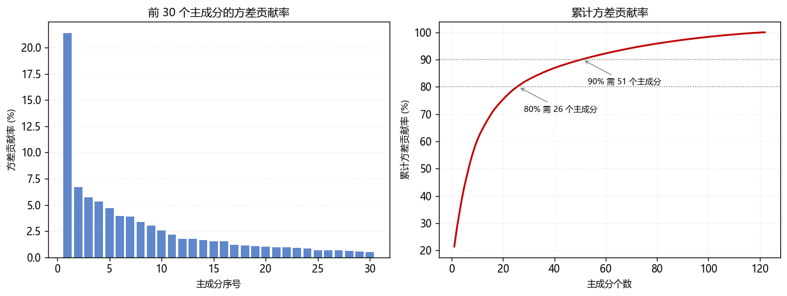

**（2）t-SNE（不同 perplexity）**

| perplexity | 轮廓系数 |
|-----------|---------|
| 5 | 0.138 |
| 15 | 0.080 |
| 30 | 0.113 |

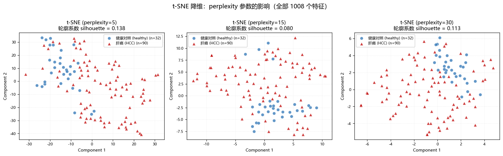

**（3）自编码器**

| 隐层维度 k | 重构 MSE（训练集） | 轮廓系数 |
|-----------|------------------|---------|
| 2 | 0.1174 | −0.097 |
| 8 | 0.0014 | — |

**（4）三种方法对比汇总**

| 降维方法 | 轮廓系数（前 2 维） | kNN 5 折 CV 准确率 | 说明 |
|---------|------------------|------------------|------|
| PCA (PC1–PC2) | −0.026 | 0.8985 | 前 2 维解释方差 28.1% |
| t-SNE (perp=5) | 0.138 | 0.8149 | 非线性，保留局部结构 |
| t-SNE (perp=15) | 0.080 | 0.8431 | 非线性，保留局部结构 |
| t-SNE (perp=30) | 0.113 | 0.8645 | 非线性，保留局部结构 |
| 自编码器 (隐层 2) | −0.097 | 0.8415 | 重构 MSE 0.1174 |
| 自编码器 (隐层 8) | — | 0.8857 | 重构 MSE 0.0014 |
| 全部 1008 特征（基线） | −0.026 | 0.8103 | — |

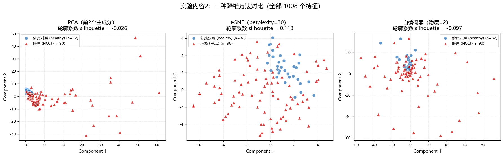

自编码器的训练损失曲线如图 4，呈稳定下降后收敛，训练过程本身是正常的：

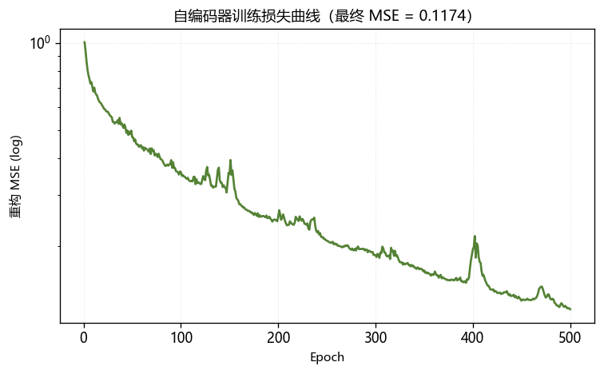{width=62%}

**（5）关于自编码器重构误差的重要修正**

上表中自编码器隐层 8 维的训练重构 MSE 低至 0.0014，单看这个数字，
它似乎比线性 PCA 强得多（PCA 要 26 个主成分才能解释 80% 的方差）。
**但这个结论是错的**：该数字是在**训练集自身**上计算的，而本网络约有
50 万个参数，样本却只有 122 个，网络完全有能力把训练样本"背下来"。

为得到可靠结论，我们做了 5 折交叉验证：每折在训练集上拟合、
在**未参与训练的测试集**上计算重构 MSE，结果如下（特征已标准化，
故 MSE 可直接读作"未解释方差比例"）：

| 隐层/主成分维度 k | PCA 留出集 MSE | 自编码器留出集 MSE | 自编码器训练集 MSE |
|-----------------|--------------|-----------------|-----------------|
| 2 | **0.8372** | 1.0134 | 0.2507 |
| 8 | **0.6965** | 0.8043 | 0.0283 |

结论完全反转过来了：**在留出集上，自编码器的重构误差反而高于线性 PCA**
（k=8 时 0.8043 vs 0.6965）。隐层 8 维的训练 MSE 0.0014 与留出 MSE 0.8043
相差约 570 倍，是典型的过拟合表现。

因此在本数据规模下（122 样本），**自编码器并没有带来优于 PCA 的降维能力**，
其看似极低的重构误差只是记住了训练样本。

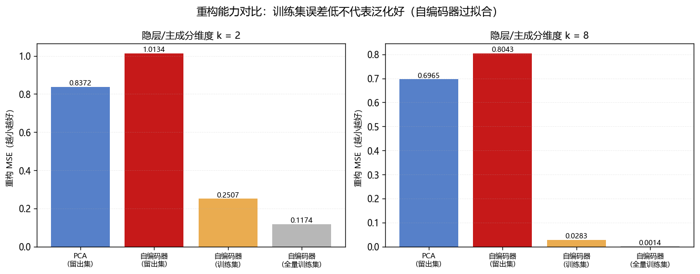

### 4.3 小结

* **三种方法在二维平面上都无法把肝癌与对照清晰分开。** PCA 的轮廓系数
  为 −0.026（负值意味着两类在二维空间中严重重叠，甚至比随机分布更交错），
  自编码器（隐层 2）为 −0.097，同样为负。t-SNE 的轮廓系数略高（0.080~0.138），
  在图中能看到健康对照有聚成小团的倾向，但重叠依然明显。

* **"二维图上分不开"不等于"数据里没有类别信息"。** 一个关键佐证是：
  同样这批全特征数据，直接用 kNN 在**完整的 1008 维空间**中做 5 折交叉验证，
  准确率就已达 0.8103，远高于随机猜测（若全预测为多数类 HCC，准确率约为
  90/122 = 73.8%）。这说明区分类别的信息是存在的，只是分散在许多个维度上，
  被前两个主成分（仅 28.08% 方差）严重稀释了。

* t-SNE 的结果对 perplexity 敏感且非单调（5→0.138，15→0.080，30→0.113）。
  需要注意 t-SNE 主要保留**局部邻域**结构，簇与簇之间的距离不具可比性，
  且算法本身是随机的，因此其轮廓系数只能作为粗略参考，不宜过度解读。

---

## 五、实验内容 3：非监督学习特征筛选

### 5.1 方法与步骤

不使用任何样本标签信息，按以下两种准则对特征排序，各取排名前 N 个特征
（N = 50/100/200/500），再用 PCA 降到 2 维做可视化并与实验内容 2 对比。

1. **方差法**：对每个特征计算其在所有样本中的方差（对应 Matlab 的 `VAR`），
   按方差**降序**排列。必须使用未标准化的 `X_raw`。
2. **熵法**：对每个特征将其取值范围等分为 20 个区间，统计各区间样本数得到
   概率分布 $p$，计算 Shannon 熵

   $$H = -\sum_i p_i \log_2 p_i$$

   除以 $\log_2 20$ 归一化到 $[0,1]$，按熵**降序**排列（熵越大表示取值分布
   越均匀、信息量越大）。等宽分箱对特征的线性缩放是等变的，因此熵法结果
   在标准化前后完全一致。

### 5.2 结果

**（1）两种方法选出的特征几乎不重叠**

| N | 方差法 ∩ 熵法 | Jaccard |
|---|--------------|---------|
| 50 | 0 | 0.000 |
| 100 | 2 | 0.010 |
| 200 | 21 | 0.055 |
| 500 | 225 | 0.290 |

在 top-50 和 top-100 上，两种无监督准则选出的特征**几乎完全不重合**，
说明"方差大"和"分布均匀"是两种互不相关的特征属性。

**（2）筛选前后的量化对比**

| 方法 | N | 轮廓系数 | kNN 5 折 CV 准确率 |
|------|---|---------|------------------|
| 全部特征（基线） | 1008 | −0.026 | 0.8103 |
| 方差法 | 50 | −0.135 | 0.8267 |
| 方差法 | 100 | −0.128 | 0.8053 |
| 方差法 | 200 | −0.117 | 0.8137 |
| 方差法 | 500 | −0.106 | 0.7858 |
| 熵法 | 50 | 0.040 | 0.8003 |
| 熵法 | 100 | **0.088** | 0.8003 |
| 熵法 | 200 | 0.039 | 0.8121 |
| 熵法 | 500 | 0.083 | 0.8007 |

**（3）可视化对比**

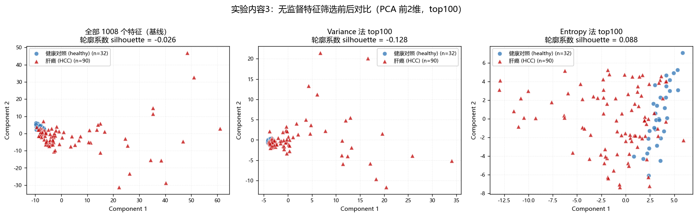

方差法 top100 的散点图与全部特征的基线图**几乎一模一样**——肝癌样本依然大幅
分散，健康对照依然挤在原点附近。熵法 top100 的图形略有改善，健康对照开始
聚成相对紧凑的一团。

### 5.3 与实验内容 2 的对比及原因分析（对应指导书 3-E）

**对比结论：熵法较基线略有改善，方差法反而使结果变差。**

具体地，方差法所有 N 下的轮廓系数（−0.106 ~ −0.135）都比基线（−0.026）
**更差**；熵法在 N=100 时达到 0.088，是把负值拉正了，但提升幅度有限。

**原因分析：**

**第一，方差法衡量的"变异大"与"能区分类别"是两件事。**
方差法完全不看标签，它挑出的是"在所有样本中波动最大"的特征。而生物数据中
最大的变异来源未必是疾病状态，也可能是个体差异、测序深度、批次效应等。
方差最大的特征可能只是"噪声大"，而不是"区分力强"。

**第二，更关键的是方差法与 PCA 的目标高度重合。**
PCA 本身就是**按方差排序**的——第一主成分就是方差最大的方向。因此"先用
方差筛掉低方差特征、再做 PCA"，与"直接对全部特征做 PCA"看到的是几乎同一批
变异方向：前者并没有改变 PC1/PC2 的朝向，只是砍掉了对它们贡献较小的特征。
这正好解释了为什么方差法的散点图与基线几乎完全一致，且轮廓系数同样为负。

这个"重合"还带来一个额外损失：被方差法丢弃的那些特征，单个来看方差很小，
但**联合起来可能携带类别信息**。丢掉它们等于既没有换到新的视角，又损失了
信息，所以方差法的表现不但没有提升，反而比基线更差。

**第三，熵法为什么略好一些？**
熵衡量的是取值分布的均匀程度，与特征的量纲和绝对波动幅度无关，捕捉的是
一个与"方差"正交的属性（两者 top-100 交集仅 2 个特征，见 5.2 节）。
正因为视角不同，熵挑出的特征子集里恰好包含了一部分与类别相关的特征，
使二维可视化略有改善。

**但必须指出一个反差：熵法让"图更好看"，却没有让"分类更准"。**
熵法的 kNN 准确率（0.8003~0.8121）与基线（0.8103）基本持平，甚至略低。
这说明熵法带来的二维散点图改善很可能是偶然的——它在 2 维可视化上恰好
把健康对照聚得紧了一些，但这种改善并未转化为真实判别能力的提升。
**这提示我们：不能只看散点图"好不好看"就下结论，必须结合量化指标。**
（这正是本报告在指导书要求之外补充 kNN 交叉验证指标的原因。）

**总体结论**：不使用标签的无监督筛选（方差、熵）对本数据的类别区分能力
**几乎没有帮助**，甚至可能有害。原因在于它们优化的目标（方差最大、
分布最均匀）与真正想要的目标（区分肝癌与对照）无关。

---

## 六、实验内容 4：监督学习特征筛选

### 6.1 方法与步骤

使用样本标签信息，实现了指导书列出的全部 5 种方法（要求为 2~3 种），
各取排名前 N 个特征（N = 50/100/200/500）再做 PCA 降维可视化：

**（1）t 检验**：逐特征做两独立样本 t 检验（Welch 法，不假设方差齐性），
按 $|t|$ 降序。对 1008 个特征同时检验会产生大量假阳性，故额外做
Benjamini-Hochberg FDR 校正。

**（2）Mann-Whitney U 检验**：非参数检验，不要求正态分布。注意直接按 p 值
排序会遇到大量并列（p 极小时的数值精度问题），故改用效应量
$|\mathrm{AUC} - 0.5|$（其中 $\mathrm{AUC} = U/(n_1 n_0)$）作为得分——
它与 p 值单调等价，但取值连续、无并列。

**（3）互信息**：用 kNN 估计器计算每个特征与标签的互信息，能捕捉非线性依赖。

**（4）mRMR**（最大相关最小冗余），严格按指导书步骤：

* A. 按各特征在所有样本中的**中值**做二值离散化；
* B. 在离散空间上做贪心前向选择，每一步在剩余特征中选取使下列准则最大者：

  $$\text{MID (互信息差)}:\quad \max_f \left[ I(f;c) - \frac{1}{|S|}\sum_{s \in S} I(f;s) \right]$$

  $$\text{MIQ (互信息商)}:\quad \max_f \left[ \frac{I(f;c)}{\frac{1}{|S|}\sum_{s \in S} I(f;s)} \right]$$

  其中 $I(f;c)$ 是特征与类的"相关项"，$I(f;s)$ 是特征间的"冗余项"。

* C. 取排名前 N 个特征降维并可视化。

  注：scikit-learn 没有内置 mRMR，本实验自行实现。为提高 1008×1008 特征
  两两互信息矩阵的计算效率，对二值特征用 $2\times2$ 列联表做了向量化计算，
  并已与 `sklearn.metrics.mutual_info_score` 逐项比对，误差在 $10^{-16}$ 量级。

**（5）Lasso 回归**：L1 正则逻辑回归，把不重要特征的系数压到精确的 0。

这里有一个实现上的陷阱需要说明。若按单一 C 值下的 $|\text{系数}|$ 排序，
在本数据上取 C=0.05 时 1008 个特征只有 3 个非零，**其余 1005 个得分完全相同
（都是 0）**，排序结果将完全由"并列如何打破"决定，并不反映 Lasso 本身的选择
倾向。为此本实验改用**正则化路径**排序（stability selection 的常用做法）：

$$\text{score}_j = \text{特征 } j \text{ 首次变为非零时的那个 } C$$

（注意 sklearn 中 C 是正则强度的倒数：C 越小惩罚越强、非零系数越少。
故 C 从小往大扫，特征会依次"进入"模型；越重要的特征越能扛住强惩罚，
首次进入的 C 越小、得分越高。）这样 1008 个特征都能得到有区分度的得分，
且不需要引入任何外部信息来打破并列。

### 6.2 结果

**（1）各方法的筛选规模**

| 方法 | 结果 |
|------|------|
| t 检验 | p<0.05 的特征 **594** 个；BH-FDR 校正后 q<0.05 的 **554** 个 |
| Mann-Whitney U | p<0.05 的特征 **529** 个 |
| Lasso | C=0.1 时严格入选 **16** 个特征 |
| Lasso 正则路径 | C=0.005:0 个，0.01:0 个，0.05:3 个，0.1:16 个，0.5:37 个，1.0:47 个 |

值得注意的是：即使经过 FDR 校正，仍有 554 个特征（超过总数一半）与类别
显著相关。这说明**单变量检验的"显著"门槛在本数据上过于宽松**——1008 个
特征里有 554 个显著，等于没怎么筛掉东西，这也解释了为什么 t 检验需要配合
"取 top-N"而不是"取所有显著特征"来使用。

**（2）不同 N 下的量化指标**

| 方法 | N | 轮廓系数 | kNN 5 折 CV 准确率 |
|------|---|---------|------------------|
| 全部特征（基线） | 1008 | −0.026 | 0.8103 |
| t 检验 | 50 | 0.207 | 0.9089 |
| t 检验 | 100 | 0.194 | 0.9072 |
| t 检验 | 200 | 0.161 | 0.8843 |
| t 检验 | 500 | 0.101 | 0.8757 |
| Mann-Whitney U | 50 | 0.201 | 0.8922 |
| Mann-Whitney U | 100 | 0.212 | 0.8939 |
| Mann-Whitney U | 200 | 0.196 | 0.8923 |
| Mann-Whitney U | 500 | 0.124 | 0.8661 |
| 互信息 | 50 | 0.181 | 0.8659 |
| 互信息 | 100 | 0.156 | 0.8873 |
| 互信息 | 200 | 0.124 | 0.8806 |
| 互信息 | 500 | 0.086 | 0.8463 |
| mRMR-MID | 50 | 0.213 | **0.9251** |
| mRMR-MID | 100 | **0.230** | 0.9087 |
| mRMR-MID | 200 | 0.204 | 0.8923 |
| mRMR-MID | 500 | 0.129 | 0.8675 |
| **Lasso（L1 路径）** | 50 | **0.307** | **0.9411** |
| **Lasso（L1 路径）** | 100 | **0.241** | **0.9397** |
| Lasso（L1 路径） | 200 | 0.122 | 0.9170 |
| Lasso（L1 路径） | 500 | 0.053 | 0.8611 |

**（3）各方法 top-10 特征**

| 方法 | top-10 特征编号 |
|------|----------------|
| 方差法 | 471, 0, 284, 278, 24, 25, 283, 304, 529, 329 |
| 熵法 | 679, 46, 44, 91, 47, 1002, 926, 881, 54, 361 |
| t 检验 | 910, 803, 806, 926, 927, 406, 522, 821, 510, 554 |
| Mann-Whitney U | 910, 545, 522, 803, 510, 774, 667, 926, 806, 787 |
| 互信息 | 668, 910, 803, 806, 927, 522, 510, 546, 702, 696 |
| mRMR-MID | 803, 283, 927, 662, 561, 772, 910, 406, 926, 36 |
| Lasso | 926, 910, 64, 821, 92, 501, 554, 416, 161, 510 |

**（4）方法间 top-100 特征集合的重叠度（Jaccard）**

| | MW | MI | mRMR | Lasso |
|---|----|----|------|-------|
| t 检验 | **0.681** | 0.333 | 0.429 | 0.143 |
| Mann-Whitney U | — | 0.439 | 0.515 | 0.130 |
| 互信息 | — | — | 0.408 | **0.093** |
| mRMR-MID | — | — | — | 0.149 |

**（5）五种方法的共识特征**

五种监督方法 top-100 的**交集恰好有 12 个特征**：
F142, F406, F487, F510, F554, F561, F629, F662, F821, F910, F923, F926。

**（6）可视化对比**


与基线（轮廓系数 −0.026，完全混杂）相比，五种监督方法 top-100 的散点图上
**健康对照都聚成了一团、并与肝癌样本拉开明显距离**，其中 mRMR-MID 和 Lasso
的效果最为清晰。

### 6.3 与实验内容 2、3 的对比及原因分析（对应指导书 4-E）

**对比结论：监督筛选显著优于无监督筛选，也显著优于不做筛选的基线。**

| 类别 | 代表方法 | 轮廓系数 | kNN CV 准确率 |
|------|---------|---------|--------------|
| 基线（不筛选） | 全部 1008 特征 | −0.026 | 0.8103 |
| 无监督筛选（最佳） | 熵法 top100 | 0.088 | 0.8003 |
| 无监督筛选 | 方差法 top100 | −0.128 | 0.8053 |
| 监督筛选 | t 检验 top100 | 0.194 | 0.9072 |
| 监督筛选 | mRMR-MID top100 | 0.230 | 0.9087 |
| 监督筛选 | Lasso top100 | 0.241 | 0.9397 |


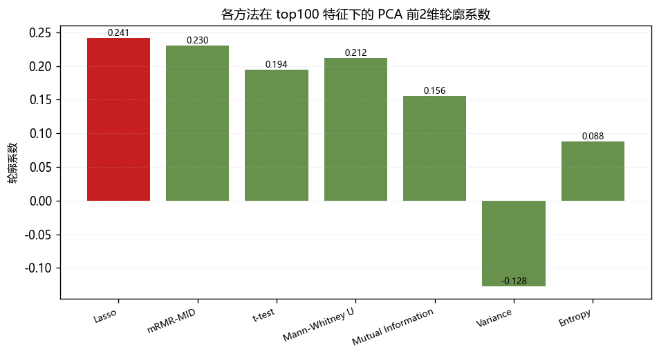

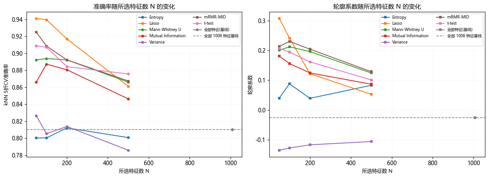

**原因分析：**

**第一，监督方法"瞄准了正确的方向"。**
无监督准则（方差、熵）的优化目标与"区分肝癌和对照"无关，所以它们在
1008 个特征里挑出的"方差最大"或"分布最均匀"的特征，很可能与类别无关。
监督方法则直接把"特征与标签的关联强度"作为打分依据，相当于把筛选方向
对准了类别轴，因此能选出**方差不大、但两类差异显著**的特征——这类特征
恰恰是无监督方法系统性忽略的。

**第二，三类监督准则的差异体现了"单变量 vs 多变量"的层次。**

* **单变量过滤式（t 检验、Mann-Whitney U、互信息）**：逐个特征独立打分，
  优点是简单、可解释（有 p 值、AUC 等统计量），缺点是完全忽略特征之间的
  冗余，容易选出高度相关的一批特征。证据很直观：t 检验与 Mann-Whitney U 的
  top-100 Jaccard 高达 **0.681**，两者本质上在测量同一个东西（两类分布的位置
  差异），只是一个用参数法、一个用秩；t 检验 p 值最小的特征（p = 8.65×10⁻¹⁸）
  对应的 Mann-Whitney U 的 AUC 低至 0.094，说明这些特征在两类间几乎完全分离。

* **mRMR**：在"相关"之外**显式惩罚冗余**，倾向于选出彼此互补的特征。
  它 top-100 与 t 检验的 Jaccard 只有 0.429（明显低于 t 检验与 MW 之间的
  0.681），说明它确实选出了一套更分散的特征。而且 mRMR 在**所有 N 下**
  准确率都稳定偏高（top50 达 0.9251），体现出"既相关又不冗余"这一策略的价值。

* **Lasso**：做的是**多变量联合**选择——所有特征同时进入模型，由 L1 惩罚
  在联合拟合的前提下决定谁留下，因此能捕捉单变量检验看不到的联合效应。
  它的表现最好（top50 准确率 0.9411、轮廓系数 0.307），且与互信息的 top-100
  重叠率低至 0.093、与 t 检验只有 0.143，说明它选的确实是一套很不一样的特征。

**第三，N 的选择规律：几乎所有方法都是"N 越小指标越好"。**
t 检验准确率随 N 从 50 增到 500 由 0.9089 降到 0.8757，Lasso 由 0.9411 降到
0.8611，所有监督方法在 N=500 时都明显回落。这符合直觉：排序靠前的特征信息
密度最高，继续往后加只会引入噪声和冗余。**本数据下最优的 N 在 50~100 量级。**
（这也解释了为什么"取所有 554 个 FDR 显著特征"是错的做法。）

**第四，共识特征最有价值。**
五种原理完全不同的准则，top-100 的交集只有 12 个特征。这 12 个特征是"无论
用哪种方法都被认为与类别最相关"的高置信特征，是后续实验（分类器构建与验证）
最值得优先考虑的候选特征。

### 6.4 一个必须说明的局限

本节的 kNN 交叉验证准确率存在**选择偏倚（selection bias）**：特征筛选是在
使用**全部样本**的标签完成的，之后才做交叉验证。这意味着测试集的信息通过
"特征选择"这一步间接泄漏到了模型中，因此表中的准确率是**乐观估计**，
绝对值会偏高。

要得到无偏估计，必须把特征筛选过程放进交叉验证的每一折内部（即在每折的
训练集上重新做特征筛选）。本实验遵循指导书的做法，在交叉验证之外完成筛选，
因此**这些数字只适合用于在相同协议下横向比较各方法的相对优劣，不宜当作
分类器性能的无偏报告**。

**同时，样本量只有 122 例，1 个样本约合 0.82% 的准确率。** 因此像 Lasso
（0.9411）与 t 检验（0.9089）之间 3.2% 的差距只相当于约 4 个样本，
不宜过度解读具体名次。可靠的结论是**定性的**：监督筛选大幅优于无监督筛选，
而不是"Lasso 一定比 t 检验好"。

---

## 七、实验结论

1. **降维方面**：PCA、t-SNE、自编码器三种方法在二维平面上都无法清晰分开
   肝癌与健康对照。前两个主成分只解释 28.08% 的方差，类别信息分散在大量
   维度上，二维可视化会严重稀释它。但直接用全部 1008 维做 kNN 交叉验证
   准确率已达 0.8103，证明类别信息确实存在——**"图上分不开"不等于"数据里
   没有信号"**。

2. **自编码器方面**：隐层 8 维的训练重构 MSE 低至 0.0014，看似远优于 PCA，
   但 5 折交叉验证的留出集 MSE（0.8043）反而**高于**线性 PCA（0.6965）。
   在 122 个样本上训练约 50 万参数的网络发生了严重过拟合。
   **只看训练集重构误差会得出完全错误的结论。**

3. **无监督特征筛选方面**：方差法与熵法对本数据帮助甚微，方差法甚至使结果
   变差（轮廓系数 −0.106 ~ −0.135，低于基线的 −0.026），根本原因是它们的
   优化目标与"区分类别"无关。方差法还与 PCA 的目标高度重合（PCA 本就按方差
   排序），因此筛选前后几乎无变化。**熵法让散点图好看了一些，但 kNN 准确率
   并未提升**，说明不能只凭可视化判断效果。

4. **监督特征筛选方面**：五种监督方法均大幅优于无监督方法与基线。
   其中基于正则化路径的 Lasso 表现最好（top50 轮廓系数 0.307、
   kNN 准确率 0.9411），mRMR 次之且在各 N 下最稳定。体现了使用标签信息
   以及"考虑特征间冗余/联合效应"的价值。

5. **方法学收获**：
   * 特征筛选应以**类别关联**为目标，而非方差、熵等与任务无关的统计量；
   * 评估降维/筛选效果不能只看散点图，必须结合量化指标，且两者可能不一致；
   * 高维小样本下要警惕过拟合，必须使用**留出集**而非训练集误差；
   * 每次筛选都要注意**选择偏倚**，本报告的准确率为相对比较用的乐观估计。

---

## 附录 A：实验代码

完整可运行代码位于 `Exp1/` 目录：

```
Exp1/
├── exp1_main.py              主程序：一键跑完全部实验
├── src/
│   ├── data_loader.py        数据加载与标签对齐（含断言校验）
│   ├── dim_reduction.py      PCA / t-SNE / 自编码器
│   ├── feat_selection.py     方差、熵、t 检验、MW、互信息、mRMR、Lasso
│   ├── evaluate.py           轮廓系数、kNN 交叉验证、留出集重构误差
│   └── visualize.py          绘图（中文字体配置）
├── results/figures/          全部结果图（17 张）
├── results/tables/           全部指标表（4 个 CSV）
├── results/metrics.json      全部原始指标
└── report/                   本报告
```

下面是几个关键实现片段（完整代码见上述文件）。

### A.1 数据加载与标签校验（`src/data_loader.py`）

```python
# ma 是 (特征, 样本)，转置成 (样本, 特征)
ma = np.asarray(mat["ma"], dtype=np.float64)
co = np.asarray(mat["co"]).ravel()
X_raw = ma.T.copy()                      # (122, 1008)

# 与 xlsx 交叉校验：co == 0 应对应 HCC，co == 1 应对应 healthy
df = _load_label_table()
id2group = dict(zip(df["sample_id"], df["group"]))
group_names = np.array([id2group[s] for s in sample_ids])

expect = np.where(co == 0, "HCC", "healthy")
mismatch = np.where(expect != group_names)[0]
assert len(mismatch) == 0, f"{len(mismatch)} 个样本的 co 与 xlsx 组名矛盾"

# 统一标签：y = 1 - co，使 1 = HCC
y = (1 - co).astype(np.int64)
X = StandardScaler().fit_transform(X_raw)   # 按特征 z-score
```

### A.2 熵法特征筛选（`src/feat_selection.py`）

```python
def shannon_entropy_per_feature(X, n_bins=20):
    """逐特征计算归一化 Shannon 熵（等宽分箱）。"""
    n_samples, n_features = X.shape
    out = np.zeros(n_features)
    max_entropy = np.log2(n_bins)
    for j in range(n_features):
        col = X[:, j]
        lo, hi = col.min(), col.max()
        if not np.isfinite(lo) or hi <= lo:
            out[j] = 0.0                     # 常数特征无信息
            continue
        counts, _ = np.histogram(col, bins=n_bins, range=(lo, hi))
        p = counts / counts.sum()
        p = p[p > 0]                         # 约定 0·log0 = 0
        out[j] = -np.sum(p * np.log2(p)) / max_entropy
    return out
```

### A.3 二值互信息的向量化计算（mRMR 的核心）

1008 个特征两两互信息共约 50 万对，逐个调用 `mutual_info_score` 太慢。
由于 mRMR 的特征已按中值二值化，可用 $2\times2$ 列联表一次性向量化求解：

```python
def _mi_from_binary_counts(n11, n10, n01, n00, n):
    """由 2x2 列联表的四个计数向量化计算互信息 I(X;Y)。"""
    n = float(n)
    p11, p10, p01, p00 = n11/n, n10/n, n01/n, n00/n
    p1_, p0_ = p11 + p10, p01 + p00      # X 的边缘分布
    p_1, p_0 = p11 + p01, p10 + p00      # Y 的边缘分布

    def term(pab, pa, pb):
        den = pa * pb
        with np.errstate(divide="ignore", invalid="ignore"):
            return np.where((pab > 0) & (den > 0), pab * np.log(pab/den), 0.0)

    return (term(p11, p1_, p_1) + term(p10, p1_, p_0)
            + term(p01, p0_, p_1) + term(p00, p0_, p_0))

# 两两互信息矩阵：n11 用矩阵乘法一次算出
n11_mat = Xb.astype(float).T @ Xb.astype(float)
redundancy = _mi_from_binary_counts(
    n11_mat, n1_col - n11_mat, n1_row - n11_mat,
    n - n1_col - n1_row + n11_mat, n)
```

该实现已与 `sklearn.metrics.mutual_info_score` 逐项比对，最大误差 $6\times10^{-16}$。

### A.4 自编码器（`src/dim_reduction.py`）

```python
class _AutoEncoderNet(nn.Module):
    """对称欠完备自编码器: 1008 -> 256 -> 64 -> latent -> 64 -> 256 -> 1008"""
    def __init__(self, n_features, latent_dim, hidden=(256, 64)):
        super().__init__()
        dims = [n_features, *hidden]
        enc, prev = [], dims[0]
        for h in dims[1:]:
            enc += [nn.Linear(prev, h), nn.GELU()]
            prev = h
        enc.append(nn.Linear(prev, latent_dim))
        self.encoder = nn.Sequential(*enc)

        dec, prev = [], latent_dim
        for h in reversed(dims[1:]):
            dec += [nn.Linear(prev, h), nn.GELU()]
            prev = h
        dec.append(nn.Linear(prev, n_features))
        self.decoder = nn.Sequential(*dec)

    def forward(self, x):
        z = self.encoder(x)
        return self.decoder(z), z
```

### A.5 留出集重构误差评估（揭示过拟合）

```python
def holdout_reconstruction(X, latent_dims=(2, 8), n_splits=5, n_epochs=500):
    """5 折交叉验证，比较 PCA 与自编码器的留出集重构误差。"""
    kf = KFold(n_splits=n_splits, shuffle=True, random_state=42)
    out = {}
    for k in latent_dims:
        pca_ho, ae_ho, ae_tr = [], [], []
        for tr, te in kf.split(X):
            # PCA：在训练集上拟合，在测试集上重构
            pca = PCA(n_components=k).fit(X[tr])
            pca_ho.append(((X[te] - pca.inverse_transform(pca.transform(X[te])))**2).mean())
            # 自编码器：在训练集上训练，在测试集上重构
            model, _ = fit_autoencoder(X[tr], latent_dim=k, n_epochs=n_epochs)
            ae_ho.append(ae_reconstruct_error(model, X[te]))
            ae_tr.append(ae_reconstruct_error(model, X[tr]))
        out[int(k)] = {"pca_holdout_mse": np.mean(pca_ho),
                       "ae_holdout_mse": np.mean(ae_ho),
                       "ae_train_mse": np.mean(ae_tr)}
    return out
```

### A.6 Lasso 正则化路径排序

```python
# 指数搜索框出路径两端：c_min 处无特征进入，c_max 处几乎全部进入
c_min = 1.0
while n_nonzero(c_min) > 0:  c_min /= 2.0
c_max = 1.0
while n_nonzero(c_max) < 0.98 * n_features:  c_max *= 2.0

# 沿路径记录每个特征的"首次进入点"
entry_C = np.full(n_features, np.inf)
entered = np.zeros(n_features, dtype=bool)
for c in np.geomspace(c_min, c_max, n_alphas):   # C 由小到大
    active = np.abs(_fit_l1_logistic(X, y, c)) > 0
    entry_C[active & ~entered] = c               # 首次进入，记下该 C
    entered |= active

# entry_C 越小越重要 -> 取负号作得分
scores = np.where(np.isfinite(entry_C), -entry_C, -np.inf)
```

---

## 附录 B：各方法 top20 特征得分图

### B.1 无监督方法

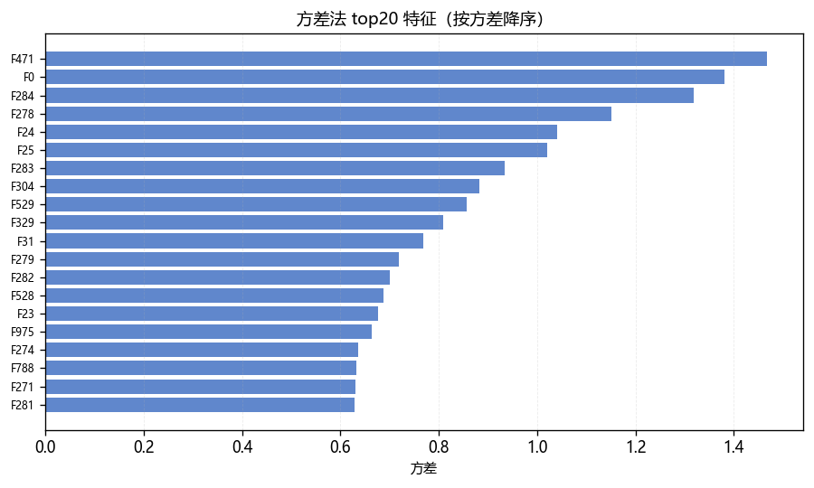{width=88%}

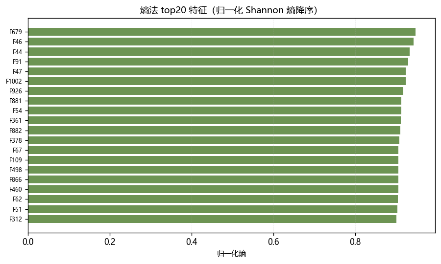{width=88%}

### B.2 监督方法

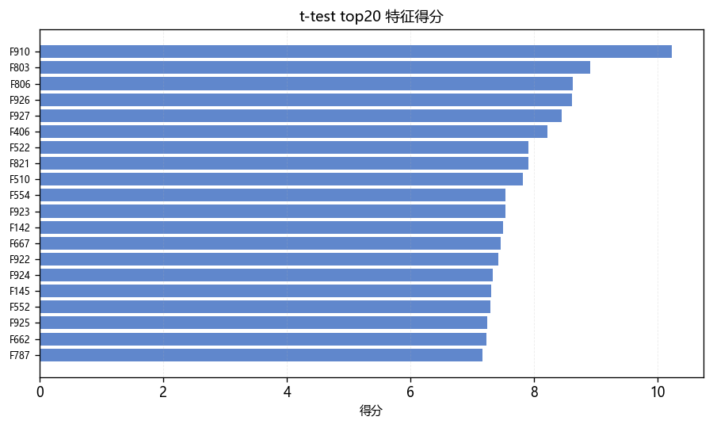{width=88%}

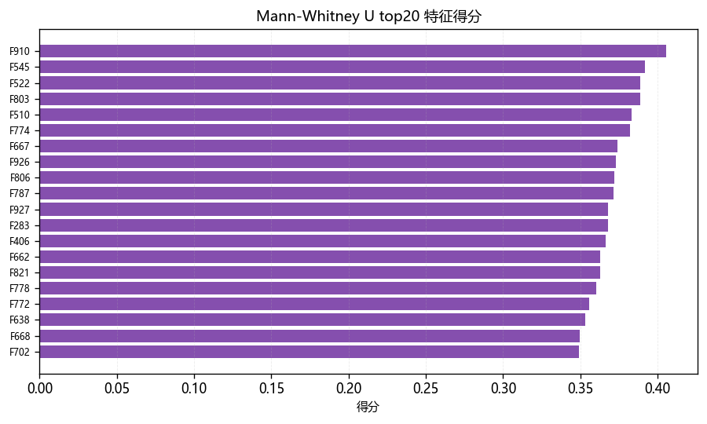{width=88%}

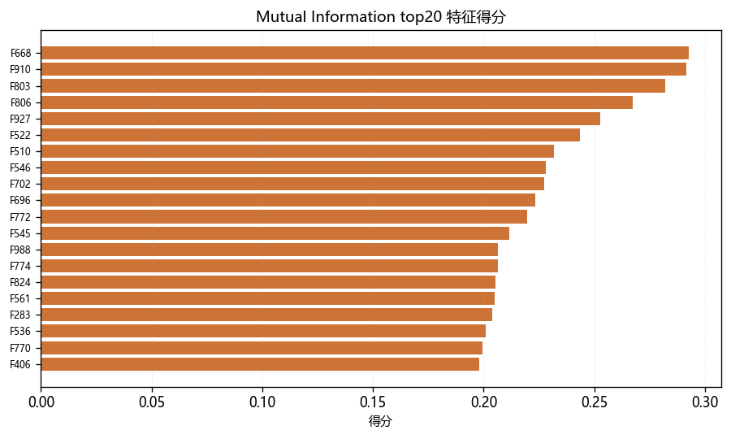{width=88%}

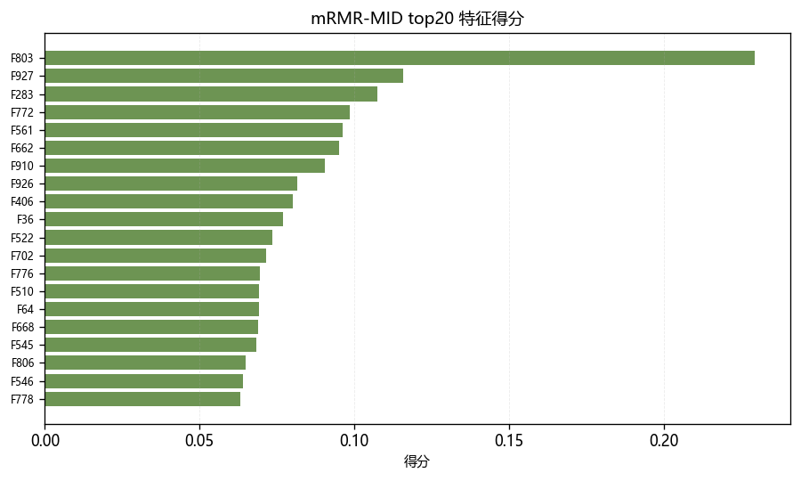{width=88%}

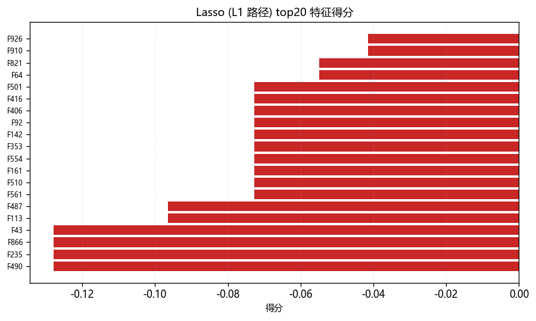{width=88%}

---

## 附录 C：结果文件清单

### 结果图（`results/figures/`）

| 文件 | 内容 |
|------|------|
| `fig02_pca_spectrum.png` | PCA 碎石图 + 累计方差贡献率曲线 |
| `fig03_dr_comparison.png` | 三种降维方法对比（PCA / t-SNE / 自编码器） |
| `fig04_tsne_perplexity.png` | t-SNE 在 perplexity=5/15/30 下的对比 |
| `fig05_ae_loss.png` | 自编码器训练损失曲线 |
| `fig05b_holdout_reconstruction.png` | 重构能力对比：训练集 vs 留出集（过拟合证据） |
| `fig06_unsup_fs_pca.png` | 无监督筛选前后对比（基线 / 方差 / 熵） |
| `fig06b_variance_scores.png` | 方差法 top20 特征得分 |
| `fig06c_entropy_scores.png` | 熵法 top20 特征得分 |
| `fig07_sup_fs_pca.png` | 五种监督筛选方法对比 |
| `fig07b`~`fig07f_*_scores.png` | 五种监督方法各自 top20 特征得分 |
| `fig08_knn_acc_comparison.png` | 各方法 top100 下 kNN 准确率对比 |
| `fig09_silhouette_comparison.png` | 各方法 top100 下轮廓系数对比 |
| `fig10_metric_vs_N.png` | 指标随所选特征数 N 的变化曲线 |

### 指标表（`results/tables/`）

| 文件 | 内容 |
|------|------|
| `tab01_dr_metrics.csv` | 降维方法指标对比 |
| `tab02_unsup_fs_metrics.csv` | 无监督特征筛选指标 |
| `tab03_sup_fs_metrics.csv` | 监督特征筛选指标 |
| `tab04_all_methods_metrics.csv` | 全部方法汇总 |

### 原始指标（`results/metrics.json`）

包含本报告引用的全部数值，便于核对与复现。
