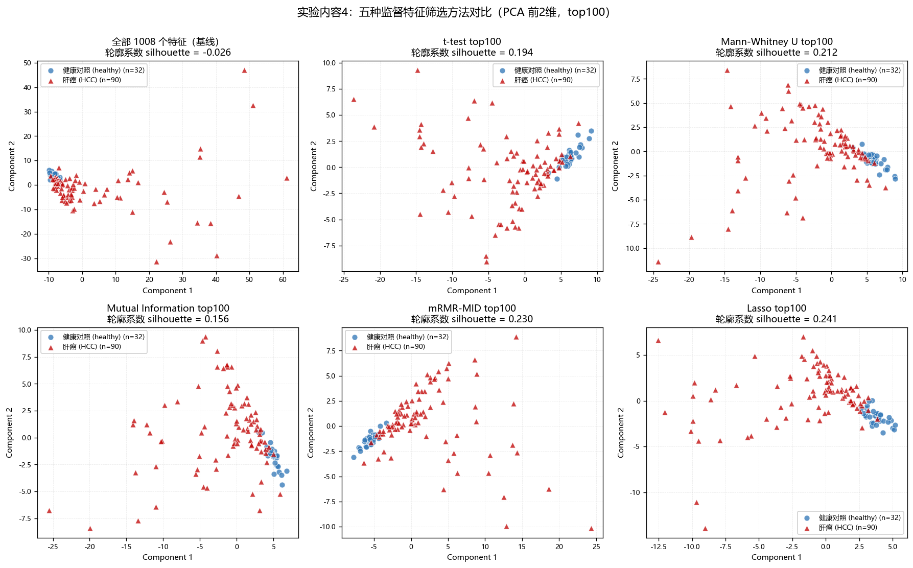
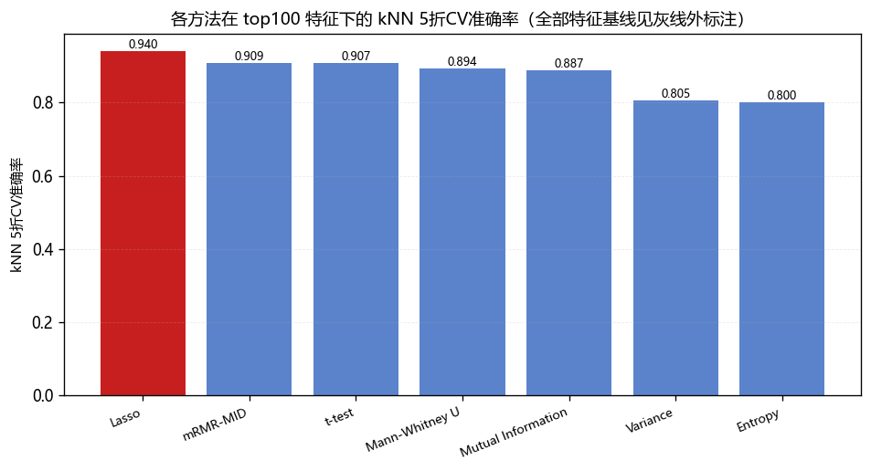

# 《生物医学智能信息处理》实验一：数据降维与特征筛选

---

## 一、实验目的

1. 掌握常见的数据降维方法（主成分分析、t-SNE、自编码器）与特征筛选方法
   （方差、熵、t 检验、Mann-Whitney U 检验、互信息、mRMR、Lasso 回归）。
2. 通过实验了解不同方法在生物医学高维小样本数据中的适用性差异，理解
   "无监督筛选"与"监督筛选"在优化目标上的本质区别。
3. 掌握生物医学数据的可视化方法，学会用散点图结合量化指标判断样本在降维
   空间中是否具有类别分布模式。

---

## 二、实验数据

肝癌（HCC）血浆 cfDNA 片段模式数据，`ma` 为特征矩阵，`co` 为类别编码。

| 项目 | 数值 |
|------|------|
| 样本数 | 122（**肝癌 90 例** / 健康对照 32 例） |
| 特征数 | 1008 |
| 缺失值 | 无 |

**标签对齐（关键）**：`ma` 是"一行一个特征、一列一个样本"，读入后需转置为
122×1008。`co` 的编码方向容易出错——实测 `co=0` 对应 **HCC**、`co=1` 对应
healthy，与 xlsx 的 `1=healthy, 2=HCC` **恰好相反**；且不能按样本 ID 首字母
判断（`GM1100` 是 G 前缀但为 HCC）。代码中与 xlsx 组名**逐样本交叉校验**
（122/122 通过）并统一为 `y = 1 - co`（1=肝癌）。

各特征方差相差逾 140 倍（0.0102~1.4678），故对 PCA/t-SNE/自编码器统一做
z-score 标准化；**方差法必须用未标准化矩阵**，否则各特征方差恒为 1、排序失效。

---

## 三、使用的方法

| # | 方法 | 类别 | 原理要点 |
|---|------|------|---------|
| 1 | PCA | 降维 | 线性、无监督、确定性；按方差贡献率排序 |
| 2 | t-SNE | 降维 | 非线性、无监督、随机；保留局部邻域结构 |
| 3 | 自编码器 | 降维 | 1008→256→64→latent→64→256→1008，MSE 重构，取编码器输出 |
| 4 | 方差法 | 无监督筛选 | 特征在所有样本中的方差，降序 |
| 5 | 熵法 | 无监督筛选 | 等宽分箱后的 Shannon 熵（归一化到 [0,1]），降序 |
| 6 | t 检验 | 监督筛选 | 两独立样本 Welch t 检验，按 \|t\| 降序；附 BH-FDR 校正 |
| 7 | Mann-Whitney U | 监督筛选 | 非参数秩检验，按效应量 \|AUC−0.5\| 降序 |
| 8 | 互信息 | 监督筛选 | kNN 估计，可捕捉非线性依赖 |
| 9 | mRMR | 监督筛选 | 按中值二值化后，最大化 I(f;c)、最小化特征间冗余（MID/MIQ 准则） |
| 10 | Lasso | 监督筛选 | L1 正则逻辑回归，**按正则化路径排序** |

**关于 Lasso 的说明**：若按单一 C 值下的 |系数| 排序，C=0.05 时 1008 个特征
只有 3 个非零，**其余 1005 个得分全为 0**，排序完全由并列规则决定，实测会与
t 检验结果完全重合（Jaccard=1.000）。故改用**正则化路径**——C 从小往大扫
（sklearn 中 C 是正则强度倒数），以"特征首次变为非零时的 C"作为得分，
越重要的特征越能扛住强惩罚、得分越高。改后与 t 检验的重叠降至 0.143。

**关于 mRMR**：scikit-learn 无内置实现，按指导书步骤自行实现。为避免 1008
个特征两两互信息（约 50 万对）逐个调用函数，对二值特征用 2×2 列联表做了
向量化，并与 `sklearn.metrics.mutual_info_score` 逐项比对，误差 $6\times10^{-16}$。

---

## 四、处理流程

```
载入 .mat + .xlsx
   └─ 转置 ma 为 122×1008
   └─ 与 xlsx 逐样本交叉校验标签（断言，不一致即报错）
   └─ 统一标签 y = 1 - co（1=肝癌）
   └─ 按特征 z-score → X（同时保留未标准化的 X_raw）
        │
        ├─【实验内容2】全部 1008 特征降维
        │     PCA（碎石图+累计贡献率）、t-SNE（perplexity 5/15/30）、
        │     自编码器（latent=2 / 8）
        │     └─ 输出 2 维散点图 + 轮廓系数
        │     └─ 补充：5 折留出集重构误差（检验自编码器是否过拟合）
        │
        ├─【实验内容3】无监督特征筛选（不用标签）
        │     方差法（基于 X_raw）、熵法（基于 X）
        │     └─ 各取 top-N（N=50/100/200/500）
        │     └─ PCA 降维 + 散点图 + 轮廓系数 + kNN 交叉验证
        │
        ├─【实验内容4】监督特征筛选（用标签）
        │     t 检验、Mann-Whitney U、互信息、mRMR、Lasso（5 种）
        │     └─ 各取 top-N（N=50/100/200/500）
        │     └─ 同上评估 + 方法间 top-100 重叠度（Jaccard）
        │
        └─ 汇总对比 → 17 张图 + 4 张表 + metrics.json
```

**评估指标**：指导书只要求观察散点图，但肉眼比较缺乏说服力，故补充两个客观指标。

* **轮廓系数**：降维后 2 维空间中两类的分离程度，取值 [−1,1]，越接近 1 越好。
* **kNN 5 折交叉验证准确率**：所选特征子集的判别能力，重复 5 次不同划分取平均。

---

## 五、实验结果

### 5.1 实验内容 2：数据降维

| 降维方法 | 轮廓系数（前 2 维） | 说明 |
|---------|------------------|------|
| PCA (PC1–PC2) | −0.026 | 前 2 维仅解释 **28.08%** 方差；达 80% 需 26 个主成分 |
| t-SNE (perp=5) | 0.138 | 非线性 |
| t-SNE (perp=15) | 0.080 | 非线性 |
| t-SNE (perp=30) | 0.113 | 非线性 |
| 自编码器 (latent=2) | −0.097 | 训练重构 MSE 0.1174 |
| 自编码器 (latent=8) | — | 训练重构 MSE 0.0014 |
| **全部 1008 特征（基线）** | −0.026 | **kNN CV 准确率 0.8103** |

**结论**：三种方法在二维平面上**都无法清晰分开**肝癌与对照（PCA 与自编码器
轮廓系数均为负，说明两类在 2 维空间中严重重叠）。但直接用全部 1008 维做 kNN
交叉验证准确率已达 0.8103，说明**类别信息确实存在，只是分散在大量维度上**，
被前两个主成分（仅 28.08% 方差）严重稀释。**"图上分不开"≠"没有信号"。**

### 5.2 自编码器的重要修正：训练误差低不等于泛化好

隐层 8 维的训练重构 MSE 仅 0.0014，看似远优于 PCA。但该网络约 50 万参数、
样本仅 122 个，该数字是**训练集自身**的误差，不可信。补做 5 折留出集验证：

| 维度 k | PCA 留出集 MSE | 自编码器留出集 MSE | 自编码器训练集 MSE |
|-------|--------------|-----------------|-----------------|
| 2 | **0.8372** | 1.0134 | 0.2507 |
| 8 | **0.6965** | 0.8043 | 0.0283 |

**结论完全反转**：留出集上自编码器重构误差**反而高于**线性 PCA（0.8043 vs
0.6965）。隐层 8 维训练 MSE 0.0014 与留出 MSE 0.8043 相差约 570 倍，是典型
过拟合。**本数据规模下自编码器没有带来优于 PCA 的降维能力。**

### 5.3 实验内容 3：无监督特征筛选

| 方法 | N | 轮廓系数 | kNN CV 准确率 |
|------|---|---------|--------------|
| 全部特征（基线） | 1008 | −0.026 | 0.8103 |
| 方差法 | 50 | −0.135 | 0.8267 |
| 方差法 | 100 | −0.128 | 0.8053 |
| 方差法 | 200 | −0.117 | 0.8137 |
| 方差法 | 500 | −0.106 | 0.7858 |
| 熵法 | 50 | 0.040 | 0.8003 |
| 熵法 | 100 | **0.088** | 0.8003 |
| 熵法 | 200 | 0.039 | 0.8121 |
| 熵法 | 500 | 0.083 | 0.8007 |

两种方法选出的特征**几乎完全不重叠**（top-50 交集为 0，top-100 仅 2 个），
说明"方差大"与"分布均匀"是互不相关的属性。

**结论**：**方差法反而使结果变差**（所有 N 下轮廓系数 −0.106~−0.135，均低于
基线的 −0.026）；熵法略有改善但有限。原因见第七节。

### 5.4 实验内容 4：监督特征筛选

**筛选规模**

| 方法 | 结果 |
|------|------|
| t 检验 | p<0.05 共 594 个；BH-FDR 校正后 q<0.05 仍有 **554** 个 |
| Mann-Whitney U | p<0.05 共 529 个 |
| Lasso | C=0.1 时严格入选 16 个（C=0.05 时仅 3 个，C=1.0 时 47 个） |

即使 FDR 校正后仍有 554 个特征"显著"，超过总数一半，说明**单变量检验的显著
门槛在本数据上过于宽松**，必须配合"取 top-N"使用。

**各方法指标**

| 方法 | N | 轮廓系数 | kNN CV 准确率 |
|------|---|---------|--------------|
| 全部特征（基线） | 1008 | −0.026 | 0.8103 |
| t 检验 | 100 | 0.194 | 0.9072 |
| Mann-Whitney U | 100 | 0.212 | 0.8939 |
| 互信息 | 100 | 0.156 | 0.8873 |
| mRMR-MID | 100 | 0.230 | 0.9087 |
| **Lasso（L1 路径）** | **50** | **0.307** | **0.9411** |
| **Lasso（L1 路径）** | **100** | 0.241 | **0.9397** |

（完整 N=50/100/200/500 结果见 `results/tables/tab03_sup_fs_metrics.csv`）

**方法间 top-100 重叠度（Jaccard）**

| | MW | 互信息 | mRMR | Lasso |
|---|----|-------|------|-------|
| t 检验 | **0.681** | 0.333 | 0.429 | 0.143 |
| Mann-Whitney U | — | 0.439 | 0.515 | 0.130 |
| 互信息 | — | — | 0.408 | **0.093** |

**共识特征**：五种方法 top-100 的**交集有 12 个**：
F142, F406, F487, F510, F554, F561, F629, F662, F821, F910, F923, F926。





---

## 六、结果汇总

| 类别 | 代表方法 | 轮廓系数 | kNN CV 准确率 |
|------|---------|---------|--------------|
| 基线（不筛选） | 全部 1008 特征 | −0.026 | 0.8103 |
| 无监督筛选（最佳） | 熵法 top100 | 0.088 | 0.8003 |
| 无监督筛选（最差） | 方差法 top100 | −0.128 | 0.8053 |
| 监督筛选 | t 检验 top100 | 0.194 | 0.9072 |
| 监督筛选 | mRMR-MID top100 | 0.230 | 0.9087 |
| **监督筛选（最佳）** | **Lasso top50** | **0.307** | **0.9411** |

---

## 七、结论与原因分析

### 7.1 为什么无监督筛选几乎无效（对应指导书 3-E）

**方差法为何反而变差？**

1. **"变异大"不等于"能区分类别"。** 方差法不看标签，挑的是波动最大的特征。
   生物数据中最大的变异来源未必是疾病状态，也可能是个体差异、测序深度、
   批次效应。方差大可能只是"噪声大"。
2. **方差法与 PCA 目标高度重合。** PCA 本身就按方差排序，第一主成分就是方差
   最大的方向。因此"先按方差筛、再做 PCA"与"直接对全部特征做 PCA"看到的是
   几乎同一批变异方向——这解释了为什么方差法的散点图与基线几乎一模一样。
3. **由此还额外损失了信息**：被丢弃的特征单个方差小，但**联合起来可能携带
   类别信息**。既没换到新视角、又丢了信息，所以比基线更差。

**熵法为何略好？** 熵衡量取值分布的均匀程度，与量纲和绝对波动幅度无关，
捕捉的是与"方差"正交的属性（两者 top-100 交集仅 2 个），因此恰好挑到了一部分
与类别相关的特征。

**但要注意一个反差**：熵法让散点图好看了，kNN 准确率却**并未提升**
（0.8003 vs 基线 0.8103）。说明二维可视化的改善很可能是偶然的。
**不能只看散点图下结论，必须结合量化指标**——这正是本实验补充 kNN 指标的原因。

### 7.2 为什么监督筛选显著更优（对应指导书 4-E）

1. **监督方法瞄准了正确的方向。** 直接把"特征与标签的关联强度"作为打分依据，
   因此能选出**方差不大、但两类差异显著**的特征——这类特征恰恰被无监督方法
   系统性忽略。

2. **单变量 vs 多变量的层次差异。**
   * **单变量过滤式（t 检验、MW、互信息）**：逐个特征独立打分，简单可解释，
     但忽略特征间冗余。证据：t 检验与 MW 的 top-100 **Jaccard 高达 0.681**，
     两者本质在测同一样东西（两类分布的位置差异），只是参数/非参数之别。
   * **mRMR**：显式惩罚冗余，选出彼此互补的特征。与 t 检验重叠仅 0.429，
     且**在所有 N 下准确率都最稳定**（top50 达 0.9251）。
   * **Lasso**：多变量联合选择，所有特征同时进入模型、由 L1 决定谁留下，
     能捕捉单变量检验看不到的联合效应。表现最好（top50 准确率 0.9411、轮廓
     系数 0.307），且与互信息 top-100 重叠率低至 0.093，选的是一套很不一样的特征。

3. **N 的选择规律：几乎所有方法都是 N 越小指标越好。** t 检验准确率随 N 从 50
   增到 500 由 0.9089 降到 0.8757，Lasso 由 0.9411 降到 0.8611。说明排序靠前的
   特征信息密度最高，继续加只会引入噪声和冗余。**本数据最优 N 在 50~100 量级。**

4. **共识特征最有价值。** 五种原理不同的准则交集仅 12 个特征，是"无论用哪种
   方法都被认为与类别最相关"的高置信特征，是后续实验 4（分类器构建）最值得
   优先考虑的候选。

### 7.3 本次实验的局限

* **选择偏倚**：特征筛选使用了全部样本的标签，之后才做交叉验证，测试集信息
  通过"特征选择"间接泄漏，故表中 kNN 准确率是**乐观估计**。要得到无偏估计须把
  筛选放进每折 CV 内部。本实验遵循指导书做法，因此这些数字**只适合在相同协议下
  横向比较各方法**，不宜当作分类器性能的无偏报告。
* **样本量小**：仅 122 例，1 个样本约合 0.82% 准确率。故 Lasso（0.9411）与
  t 检验（0.9089）之间 3.2% 的差距只相当于约 4 个样本，**不宜过度解读名次**。
  可靠的结论是定性的：**监督筛选大幅优于无监督筛选**。
* **t-SNE 的轮廓系数仅作参考**：t-SNE 保留局部结构、簇间距离不具可比性且
  算法随机，其轮廓系数不宜过度解读。

---

## 附录：核心代码

以下代码由 `report/gen_brief.py` 从 `src/` 与 `exp1_main.py` 的真实源文件中
按符号名自动抽取，与跑出本报告结果的代码一致。抽取时只做了一处改动：
把函数体内部的相对导入（`from .dim_reduction import ...`）去掉，共 1 处——拼成单文件后这些名字已在同一文件顶层定义。

**关于完整性**：附录收录了全部算法与评估代码。绘图代码（`src/visualize.py`，
约 250 行，仅含 `matplotlib` 绘图封装与中文字体配置）不属于算法核心，
为控制篇幅未列入；补上该文件后，附录代码即可端到端运行并复现全部结果
（已实测：拼装后 113 个指标字段与报告完全一致）。
完整源码见提交的 `Exp1/` 目录，共 6 个模块 1801 行。

### 源码结构

```
Exp1/
├── exp1_main.py              主程序：一键完成实验内容 2/3/4
├── src/
│   ├── data_loader.py        数据加载与标签校验
│   ├── dim_reduction.py      PCA / t-SNE / 自编码器
│   ├── feat_selection.py     方差、熵、t 检验、MW、互信息、mRMR、Lasso
│   ├── evaluate.py           轮廓系数、kNN 交叉验证、留出集重构误差
│   └── visualize.py          绘图（中文字体配置）
├── results/                  17 张结果图 + 4 张指标表 + metrics.json
└── report/                   实验报告
```

---

## 一、运行环境准备

### 1. 导入依赖

```python
from __future__ import annotations
from dataclasses import dataclass
from pathlib import Path
import numpy as np
import pandas as pd
from scipy.io import loadmat
from sklearn.preprocessing import StandardScaler
import warnings
from dataclasses import dataclass, field
import torch
import torch.nn as nn
from sklearn.decomposition import PCA
from sklearn.manifold import TSNE
from scipy import stats
from sklearn.feature_selection import mutual_info_classif
from sklearn.linear_model import LogisticRegression
from sklearn.metrics import silhouette_score
from sklearn.model_selection import StratifiedKFold, cross_val_score
from sklearn.neighbors import KNeighborsClassifier
from sklearn.pipeline import make_pipeline
import json
import sys
import time
import matplotlib.pyplot as plt
```

### 2. 路径与全局随机种子

> **注意**：本脚本需与 `实验1-数据/` 目录同级（即放在 `Exp1/` 下）才能找到数据文件。
> 全部随机过程（t-SNE、自编码器、交叉验证划分）都固定为同一个种子，保证结果可复现。

```python
# 项目根目录：本脚本所在目录
PROJECT_ROOT = Path(__file__).resolve().parent
DATA_DIR = PROJECT_ROOT / "实验1-数据"
MAT_PATH = DATA_DIR / "PNAS_HCC.mat"
XLSX_PATH = DATA_DIR / "PNAS_id_inforamtion.xlsx"

# 全局随机种子
RANDOM_STATE = 42

# 类别名称：索引即 y 的取值
CLASS_NAMES = {0: "healthy", 1: "HCC"}
CLASS_NAMES_CN = {0: "健康对照", 1: "肝癌"}
```

### 3. 输出目录与实验参数

```python
FIG_DIR = PROJECT_ROOT / "results" / "figures"
TAB_DIR = PROJECT_ROOT / "results" / "tables"
METRICS_PATH = PROJECT_ROOT / "results" / "metrics.json"
TOP_N_LIST = [50, 100, 200, 500]
PLOT_N = 100
```

### 4. 数据结构

各模块统一使用的 dataclass 容器。

**`Exp1Data`**

```python
@dataclass
class Exp1Data:
    """实验一数据集容器。

    Attributes
    ----------
    X_raw : ndarray, shape (n_samples, n_features)
        原始特征矩阵，已转置为"一行一个样本"。未做任何缩放。
    X : ndarray, shape (n_samples, n_features)
        按特征 z-score 标准化后的矩阵（mean=0, std=1）。
    y : ndarray, shape (n_samples,)
        类别标签，1 = HCC(肝癌)，0 = healthy(对照)。
    sample_ids : list[str]
        样本ID，顺序与 X / y 的行一一对应。
    feature_names : list[str]
        特征名。原数据无特征名，按 0..1007 编号。
    group_names : ndarray, shape (n_samples,)
        xlsx 中的原始组名，仅用于校验与展示。
    """

    X_raw: np.ndarray
    X: np.ndarray
    y: np.ndarray
    sample_ids: list
    feature_names: list
    group_names: np.ndarray

    @property
    def n_samples(self) -> int:
        return self.X.shape[0]

    @property
    def n_features(self) -> int:
        return self.X.shape[1]

    def summary(self) -> str:
        n1 = int((self.y == 1).sum())
        n0 = int((self.y == 0).sum())
        return (
            f"样本数 {self.n_samples}（HCC {n1} / healthy {n0}），"
            f"特征数 {self.n_features}"
        )
```

**`PCAResult`**

```python
@dataclass
class PCAResult:
    embedding: np.ndarray          # (n_samples, n_components) 主成分得分
    explained_variance_ratio: np.ndarray
    n_components: int

    @property
    def cum_explained(self) -> np.ndarray:
        return np.cumsum(self.explained_variance_ratio)
```

**`AEResult`**

```python
@dataclass
class AEResult:
    embedding: np.ndarray                 # (n_samples, latent_dim)
    losses: list = field(default_factory=list)   # 每个 epoch 的训练 MSE
    final_recon_mse: float = float("nan")
    latent_dim: int = 2
    n_epochs: int = 0
```

**`SelectionResult`**

```python
@dataclass
class SelectionResult:
    """一次特征筛选的结果。

    Attributes
    ----------
    name : 方法名
    scores : (n_features,) 得分，越大越重要
    ranking : (n_features,) 特征下标，按得分降序
    meta : 附加信息（p 值、非零系数个数等），供报告使用
    """

    name: str
    scores: np.ndarray
    ranking: np.ndarray
    meta: dict = field(default_factory=dict)

    def top(self, n: int) -> np.ndarray:
        """返回排名前 n 的特征下标（已按重要性降序）。"""
        return self.ranking[:n]
```


### 5. 辅助函数

**`_load_label_table`**

```python
def _load_label_table() -> pd.DataFrame:
    """读取 xlsx 标签表并补上列名（原文件无表头）。"""
    df = pd.read_excel(XLSX_PATH, header=None, names=["sample_id", "group", "code"])
    df["sample_id"] = df["sample_id"].astype(str).str.strip()
    return df
```

**`ae_reconstruct_error`**

```python
def ae_reconstruct_error(model, X_test: np.ndarray) -> float:
    """用已训练的自编码器在给定数据上计算重构 MSE。"""
    Xt = torch.as_tensor(np.asarray(X_test), dtype=torch.float32)
    model.eval()
    with torch.no_grad():
        recon, _ = model(Xt)
        return nn.MSELoss()(recon, Xt).item()
```

**`_fit_l1_logistic`**

```python
def _fit_l1_logistic(X: np.ndarray, y: np.ndarray, C: float) -> np.ndarray:
    """拟合一个 L1 正则逻辑回归，返回系数向量（长度 = 特征数）。"""
    clf = LogisticRegression(
        penalty="l1", solver="liblinear", C=C, max_iter=5000,
        random_state=RANDOM_STATE,
    )
    clf.fit(X, y)
    return clf.coef_.ravel()
```


---

## 二、各模块核心代码

### src/data_loader.py

对应指导书：实验数据读取。**关键点是标签对齐**——`co` 与 xlsx 编码相反，
代码用断言逐样本校验，不一致直接报错而非静默错配。


**`load_exp1_data`**

```python
def load_exp1_data(standardize: bool = True, verbose: bool = True) -> Exp1Data:
    """加载实验一数据，并对齐、校验标签。

    Parameters
    ----------
    standardize : bool
        是否按特征做 z-score 标准化。PCA / t-SNE / 自编码器都对特征尺度敏感，
        而本数据各特征方差在 0.01~1.46 之间差异很大，故默认标准化。
        注意：实验内容3 的"方差法"必须用 X_raw（标准化后方差全为 1，无法排序）。
    verbose : bool
        是否打印校验信息。

    Returns
    -------
    Exp1Data

    Raises
    ------
    AssertionError
        当 .mat 与 .xlsx 的标签无法对齐或互相矛盾时抛出，避免静默错配。
    """
    mat = loadmat(MAT_PATH)

    # ---- 1. 特征矩阵：ma 是 (特征, 样本)，转置成 (样本, 特征) --------------
    ma = np.asarray(mat["ma"], dtype=np.float64)
    co = np.asarray(mat["co"]).ravel()
    sample_ids = [str(x[0]).strip() for x in mat["sample"].ravel()]

    assert ma.shape == (1008, 122), f"ma 形状异常: {ma.shape}"
    assert ma.shape[1] == len(co) == len(sample_ids), "ma 列数与标签数不一致"
    assert not np.isnan(ma).any(), "特征矩阵含 NaN"

    X_raw = ma.T.copy()  # (122, 1008)

    # ---- 2. 校验 co 的取值只能是 {0, 1} -----------------------------------
    assert set(np.unique(co).tolist()) <= {0, 1}, f"co 取值异常: {np.unique(co)}"

    # ---- 3. 与 xlsx 交叉校验 ---------------------------------------------
    df = _load_label_table()
    id2group = dict(zip(df["sample_id"], df["group"]))

    missing = [s for s in sample_ids if s not in id2group]
    assert not missing, f"以下样本在 xlsx 中缺失: {missing}"

    group_names = np.array([id2group[s] for s in sample_ids])

    # co == 0 应对应 HCC，co == 1 应对应 healthy。若此断言失败，
    # 说明数据版本变了，标签语义需要重新确认——不要放宽这个断言。
    expect = np.where(co == 0, "HCC", "healthy")
    mismatch = np.where(expect != group_names)[0]
    assert len(mismatch) == 0, (
        f"{len(mismatch)} 个样本的 co 与 xlsx 组名矛盾，例如 "
        f"{[(sample_ids[i], int(co[i]), group_names[i]) for i in mismatch[:5]]}"
    )

    # ---- 4. 统一标签：y = 1 - co，使 1 = HCC -------------------------------
    y = (1 - co).astype(np.int64)

    # ---- 5. 标准化 --------------------------------------------------------
    if standardize:
        X = StandardScaler().fit_transform(X_raw)
    else:
        X = X_raw.copy()

    feature_names = [f"F{i}" for i in range(X_raw.shape[1])]

    data = Exp1Data(
        X_raw=X_raw,
        X=X,
        y=y,
        sample_ids=sample_ids,
        feature_names=feature_names,
        group_names=group_names,
    )

    if verbose:
        print("=" * 68)
        print("数据加载完成")
        print(f"  文件        : {MAT_PATH.name} / {XLSX_PATH.name}")
        print(f"  特征矩阵 ma : {ma.shape} (特征 x 样本) -> X {X_raw.shape} (样本 x 特征)")
        print(f"  {data.summary()}")
        print(f"  标签对齐    : 122/122 样本与 xlsx 组名一致（co=0 -> HCC, co=1 -> healthy）")
        print(f"  标准化      : {'z-score (按特征)' if standardize else '无'}")
        print(f"  原始特征方差: {X_raw.var(axis=0).min():.4f} ~ {X_raw.var(axis=0).max():.4f}")
        print("=" * 68)

    return data
```


### src/dim_reduction.py

对应指导书：实验内容 2。三种降维方法统一接口。
`fit_autoencoder` 单独抽出来是为了支持留出集评估（只返回 `AEResult` 的
`autoencoder_reduce` 无法在测试集上算重构误差）。


**`pca_reduce`**

```python
def pca_reduce(X: np.ndarray, n_components: int = 2) -> PCAResult:
    """PCA 降维。

    Parameters
    ----------
    X : (n_samples, n_features) 已标准化
    n_components : 保留的主成分个数。

    Returns
    -------
    PCAResult。`embedding` 的前 2 列即为可直接画散点图的前两个主成分。
    """
    n_components = int(min(n_components, min(X.shape)))
    pca = PCA(n_components=n_components, random_state=RANDOM_STATE)
    embedding = pca.fit_transform(X)
    return PCAResult(
        embedding=embedding,
        explained_variance_ratio=pca.explained_variance_ratio_,
        n_components=n_components,
    )
```

**`pca_full_spectrum`**

```python
def pca_full_spectrum(X: np.ndarray) -> np.ndarray:
    """返回全部主成分的方差贡献率（用于画碎石图 / 累计贡献率曲线）。"""
    n = int(min(X.shape))
    pca = PCA(n_components=n, random_state=RANDOM_STATE)
    pca.fit(X)
    return pca.explained_variance_ratio_
```

**`tsne_reduce`**

```python
def tsne_reduce(
    X: np.ndarray,
    n_components: int = 2,
    perplexity: float = 30.0,
    n_iter: int = 1000,
    random_state: int = RANDOM_STATE,
) -> np.ndarray:
    """t-SNE 降维。

    perplexity 可理解为"每个点考虑的有效近邻数"，是本方法最关键的参数，
    经验取值范围约 5~50，且必须 < n_samples。本实验会扫描 5/15/30 作对比。
    """
    perplexity = float(min(perplexity, max(2.0, X.shape[0] - 1) / 3.0))
    with warnings.catch_warnings():
        warnings.simplefilter("ignore")
        tsne = TSNE(
            n_components=n_components,
            perplexity=perplexity,
            max_iter=n_iter,
            init="pca",          # pca 初始化比随机初始化更稳定
            learning_rate="auto",
            random_state=random_state,
        )
        return tsne.fit_transform(X)
```

**`_AutoEncoderNet`**

```python
class _AutoEncoderNet(nn.Module):
    """对称的欠完备自编码器：1008 -> 256 -> 64 -> latent -> 64 -> 256 -> 1008。

    隐层用 GELU；输出层不加激活（特征已标准化，取值可正可负）。
    """

    def __init__(self, n_features: int, latent_dim: int, hidden=(256, 64)):
        super().__init__()
        dims = [n_features, *hidden]
        enc, prev = [], dims[0]
        for h in dims[1:]:
            enc += [nn.Linear(prev, h), nn.GELU()]
            prev = h
        enc.append(nn.Linear(prev, latent_dim))
        self.encoder = nn.Sequential(*enc)

        dec, prev = [], latent_dim
        for h in reversed(dims[1:]):
            dec += [nn.Linear(prev, h), nn.GELU()]
            prev = h
        dec.append(nn.Linear(prev, n_features))
        self.decoder = nn.Sequential(*dec)

    def forward(self, x):
        z = self.encoder(x)
        return self.decoder(z), z
```

**`fit_autoencoder`**

```python
def fit_autoencoder(
    X: np.ndarray,
    latent_dim: int = 2,
    n_epochs: int = 500,
    lr: float = 1e-3,
    batch_size: int = 32,
    hidden=(256, 64),
    random_state: int = RANDOM_STATE,
    verbose: bool = False,
):
    """训练自编码器，返回 (model, AEResult)。

    单独抽出来是为了支持**留出集**评估：在训练集上拟合、在测试集上
    计算重构误差。仅看训练集重构误差会严重高估自编码器的能力——
    本网络约 50 万参数，而样本只有 122 个，足以把训练样本"背下来"。
    """
    torch.manual_seed(random_state)
    np.random.seed(random_state)

    Xt = torch.as_tensor(np.asarray(X), dtype=torch.float32)
    n = Xt.shape[0]

    model = _AutoEncoderNet(Xt.shape[1], latent_dim, hidden=hidden)
    opt = torch.optim.Adam(model.parameters(), lr=lr)
    loss_fn = nn.MSELoss()

    losses = []
    model.train()
    for epoch in range(n_epochs):
        perm = torch.randperm(n)
        epoch_loss, n_batch = 0.0, 0
        for i in range(0, n, batch_size):
            idx = perm[i:i + batch_size]
            xb = Xt[idx]
            opt.zero_grad()
            recon, _ = model(xb)
            loss = loss_fn(recon, xb)
            loss.backward()
            opt.step()
            epoch_loss += loss.item()
            n_batch += 1
        losses.append(epoch_loss / max(n_batch, 1))
        if verbose and (epoch + 1) % 100 == 0:
            print(f"    epoch {epoch + 1:4d}/{n_epochs}  MSE={losses[-1]:.5f}")

    # 用最终模型对全部样本编码
    model.eval()
    with torch.no_grad():
        recon, z = model(Xt)
        final_mse = loss_fn(recon, Xt).item()

    result = AEResult(
        embedding=z.numpy(),
        losses=losses,
        final_recon_mse=final_mse,
        latent_dim=latent_dim,
        n_epochs=n_epochs,
    )
    return model, result
```

**`autoencoder_reduce`**

```python
def autoencoder_reduce(X: np.ndarray, **kwargs) -> AEResult:
    """用欠完备自编码器降维，取**编码器输出**作为低维表示。

    注意：训练结束后模型处于 eval 模式（关闭 dropout 等），且本网络不含
    BatchNorm，因此整批前向与逐样本前向结果一致。
    """
    _, result = fit_autoencoder(X, **kwargs)
    return result
```


### src/feat_selection.py

对应指导书：实验内容 3（方差、熵）与实验内容 4（t 检验、MW、互信息、mRMR、Lasso）。
所有方法统一返回 `SelectionResult`（得分 + 排序）。
`_mi_from_binary_counts` 是 mRMR 的核心：把特征两两互信息从约 50 万次
单独调用变成一次 `2x2` 列联表的向量化计算。


**`variance_selection`**

```python
def variance_selection(X_raw: np.ndarray) -> SelectionResult:
    """方差法：计算每个特征在所有样本中的方差，降序排列。

    对应指导书实验内容3-A/3-B（Matlab function: VAR）。
    """
    scores = X_raw.var(axis=0, ddof=1)
    ranking = np.argsort(-scores, kind="stable")
    return SelectionResult("Variance", scores, ranking)
```

**`shannon_entropy_per_feature`**

```python
def shannon_entropy_per_feature(X: np.ndarray, n_bins: int = 20) -> np.ndarray:
    """逐特征计算 Shannon 熵（等宽分箱后的分布熵）。

    特征 j 的取值范围均分为 n_bins 个等宽区间，统计落入各区间的样本数
    得到概率分布 p，熵 H = -Σ p·log2(p)。熵越大表示该特征取值分布越均匀、
    信息量/不确定性越大。

    返回归一化到 [0,1] 的熵（除以 log2(n_bins)），便于跨特征比较。
    """
    X = np.asarray(X, dtype=np.float64)
    n_samples, n_features = X.shape
    out = np.zeros(n_features, dtype=np.float64)
    max_entropy = np.log2(n_bins)

    for j in range(n_features):
        col = X[:, j]
        lo, hi = col.min(), col.max()
        if not np.isfinite(lo) or not np.isfinite(hi) or hi <= lo:
            out[j] = 0.0          # 常数特征，无信息
            continue
        counts, _ = np.histogram(col, bins=n_bins, range=(lo, hi))
        p = counts / counts.sum()
        p = p[p > 0]              # 0·log0 约定为 0
        out[j] = -np.sum(p * np.log2(p)) / max_entropy

    return out
```

**`entropy_selection`**

```python
def entropy_selection(X: np.ndarray, n_bins: int = 20) -> SelectionResult:
    """熵法：按特征 Shannon 熵降序排列（熵高者视为信息量大）。"""
    scores = shannon_entropy_per_feature(X, n_bins=n_bins)
    ranking = np.argsort(-scores, kind="stable")
    return SelectionResult("Entropy", scores, ranking, meta={"n_bins": n_bins})
```

**`ttest_selection`**

```python
def ttest_selection(X: np.ndarray, y: np.ndarray) -> SelectionResult:
    """t 检验：逐特征做两独立样本 t 检验（Welch，不假设方差齐性），按 |t| 降序。

    返回的 meta 含原始 p 值，并额外给出 Benjamini-Hochberg FDR 校正后的
    显著特征数（1008 个特征同时检验，不校正会有大量假阳性）。
    """
    pos = X[y == 1]
    neg = X[y == 0]
    t_stat, p_val = stats.ttest_ind(pos, neg, axis=0, equal_var=False)
    t_stat = np.nan_to_num(t_stat, nan=0.0)
    p_val = np.nan_to_num(p_val, nan=1.0)

    ranking = np.argsort(-np.abs(t_stat), kind="stable")

    # BH-FDR 校正
    order = np.argsort(p_val)
    m = len(p_val)
    bh = p_val[order] * m / (np.arange(m) + 1)
    bh = np.minimum.accumulate(bh[::-1])[::-1]
    q_val = np.empty(m)
    q_val[order] = np.clip(bh, 0, 1)

    return SelectionResult(
        "t-test",
        np.abs(t_stat),
        ranking,
        meta={
            "t": t_stat,
            "p": p_val,
            "q_bh": q_val,
            "n_p<0.05": int((p_val < 0.05).sum()),
            "n_q<0.05": int((q_val < 0.05).sum()),
        },
    )
```

**`mannwhitney_selection`**

```python
def mannwhitney_selection(X: np.ndarray, y: np.ndarray) -> SelectionResult:
    """Mann-Whitney U 检验：非参数方法，不假设正态分布。

    直接按 p 值排序会遇到大量并列（尤其 p 极小值时精度受限），
    因此改用以效应量 |AUC-0.5| 作为得分——AUC = U/(n1·n0)，
    它与 p 值单调等价，但取值连续、无并列，更适合排序。
    AUC = 0.5 表示两组分布无差异，偏离越远越有判别力。
    """
    pos = X[y == 1]
    neg = X[y == 0]
    u_stat, p_val = stats.mannwhitneyu(pos, neg, axis=0, alternative="two-sided")

    n1, n0 = pos.shape[0], neg.shape[0]
    auc = u_stat / (n1 * n0)
    scores = np.abs(auc - 0.5)
    ranking = np.argsort(-scores, kind="stable")

    return SelectionResult(
        "Mann-Whitney U",
        scores,
        ranking,
        meta={"auc": auc, "p": p_val, "n_p<0.05": int((p_val < 0.05).sum())},
    )
```

**`mutual_info_selection`**

```python
def mutual_info_selection(X: np.ndarray, y: np.ndarray) -> SelectionResult:
    """互信息法：用 kNN 估计器计算每个特征与标签的互信息，降序。

    与相关系数不同，互信息能捕捉非线性依赖关系。
    """
    scores = mutual_info_classif(X, y, random_state=RANDOM_STATE, n_neighbors=5)
    ranking = np.argsort(-scores, kind="stable")
    return SelectionResult("Mutual Information", scores, ranking)
```

**`_mi_from_binary_counts`**

```python
def _mi_from_binary_counts(n11, n10, n01, n00, n):
    """由 2x2 列联表的四个计数向量化计算互信息 I(X;Y)。

    对每个位置：I = Σ p(a,b)·ln(p(a,b) / (p(a)·p(b)))，约定 0·ln0 = 0。
    """
    n = float(n)
    p11, p10, p01, p00 = n11 / n, n10 / n, n01 / n, n00 / n
    p1_, p0_ = p11 + p10, p01 + p00          # X 的边缘分布
    p_1, p_0 = p11 + p01, p10 + p00          # Y 的边缘分布

    def term(pab, pa, pb):
        num = pab
        den = pa * pb
        # 只在 pab>0 且 den>0 时贡献，否则该格贡献 0
        with np.errstate(divide="ignore", invalid="ignore"):
            val = np.where((num > 0) & (den > 0), num * np.log(num / den), 0.0)
        return val

    return (term(p11, p1_, p_1) + term(p10, p1_, p_0)
            + term(p01, p0_, p_1) + term(p00, p0_, p_0))
```

**`_binarize_by_median`**

```python
def _binarize_by_median(X: np.ndarray) -> np.ndarray:
    """按各特征在所有样本中的中值二值化（指导书实验内容4-A）。

    返回 int8 矩阵：值 > 中值记为 1，否则记为 0。
    """
    med = np.median(X, axis=0, keepdims=True)
    return (X > med).astype(np.int8)
```

**`mrmr_selection`**

```python
def mrmr_selection(
    X: np.ndarray,
    y: np.ndarray,
    n_features: int = 200,
    criterion: str = "MID",
) -> SelectionResult:
    """mRMR：最大相关最小冗余（Peng et al., 2005）。

    步骤（对应指导书实验内容4-A/4-B）：
      1. 按各特征中值二值离散化；
      2. 取前 `n_features` 个特征做贪心前向选择，每一步在剩余特征中选
         使准则最大的一个加入已选集合 S：

           MID (Mutual Information Difference):
               max_f  I(f;c) - (1/|S|) * sum_{s in S} I(f;s)
           MIQ (Mutual Information Quotient):
               max_f  I(f;c) / ((1/|S|) * sum_{s in S} I(f;s) + eps)

         其中 I(f;c) 是"相关项"，I(f;s) 是"冗余项"。

    返回的 `scores` 为 `n_features` 个特征**被选中的先后顺序**（先选得分高），
    其余特征得分置 -inf 排在末尾。
    """
    if criterion not in ("MID", "MIQ"):
        raise ValueError("criterion 只能是 'MID' 或 'MIQ'")

    Xb = _binarize_by_median(X)
    n_samples, n_feat = Xb.shape
    n_features = int(min(n_features, n_feat))

    # ---- 相关项 I(f;c)：每个二值特征与二值标签的互信息（向量化） ----------
    c = (y == 1).astype(np.int8)
    n1_ = Xb.sum(axis=0).astype(np.float64)          # 每个特征中 1 的个数
    c1 = float(c.sum())
    n11 = (Xb * c[:, None]).sum(axis=0).astype(np.float64)
    relevance = _mi_from_binary_counts(
        n11, n1_ - n11, c1 - n11, n_samples - n1_ - c1 + n11, n_samples
    )

    # ---- 冗余项 I(f;s)：特征两两互信息矩阵（向量化，1008x1008） -----------
    n11_mat = Xb.astype(np.float64).T @ Xb.astype(np.float64)
    n1_col = n1_[:, None]
    n1_row = n1_[None, :]
    redundancy = _mi_from_binary_counts(
        n11_mat,
        n1_col - n11_mat,
        n1_row - n11_mat,
        n_samples - n1_col - n1_row + n11_mat,
        n_samples,
    )
    np.fill_diagonal(redundancy, 0.0)

    # ---- 贪婪前向选择 ------------------------------------------------------
    selected: list[int] = []
    available = np.ones(n_feat, dtype=bool)
    eps = 1e-12
    # 被选中特征得分 = 其准则值；未选中为 -inf
    order_scores = np.full(n_feat, -np.inf, dtype=np.float64)

    for _ in range(n_features):
        if len(selected) == 0:
            # 第一步无冗余项，直接取相关项最大者
            crit = np.where(available, relevance, -np.inf)
        else:
            red = redundancy[:, selected].mean(axis=1)
            if criterion == "MID":
                crit = relevance - red
            else:  # MIQ
                crit = relevance / (red + eps)
            crit = np.where(available, crit, -np.inf)

        best = int(np.argmax(crit))
        order_scores[best] = crit[best]
        available[best] = False
        selected.append(best)

    # 排序：先按被选中顺序，未被选中的按相关项降序补在后面
    sel_arr = np.array(selected)
    rest = np.array([i for i in range(n_feat) if i not in set(selected)])
    rest = rest[np.argsort(-relevance[rest], kind="stable")]
    ranking = np.concatenate([sel_arr, rest])

    return SelectionResult(
        f"mRMR-{criterion}",
        order_scores,
        ranking,
        meta={
            "criterion": criterion,
            "n_selected": n_features,
            "relevance": relevance,
            "selected_order": sel_arr,
        },
    )
```

**`lasso_path_nonzero_counts`**

```python
def lasso_path_nonzero_counts(
    X: np.ndarray, y: np.ndarray,
    Cs=(0.005, 0.01, 0.05, 0.1, 0.5, 1.0),
) -> dict:
    """扫描不同的 C，返回每个 C 下非零系数的特征个数（用于报告说明稀疏性）。"""
    return {float(c): int((np.abs(_fit_l1_logistic(X, y, c)) > 0).sum()) for c in Cs}
```

**`lasso_selection`**

```python
def lasso_selection(
    X: np.ndarray,
    y: np.ndarray,
    n_alphas: int = 60,
    strict_C: float = 0.1,
) -> SelectionResult:
    """Lasso（L1 正则逻辑回归）特征筛选 —— 基于**正则化路径**排序。

    为什么不用单一 C 下的 |系数| 排序
    ---------------------------------
    L1 惩罚会把绝大多数特征的系数压成**精确的 0**。在本数据上取 C=0.05 时，
    1008 个特征里只有 3 个非零——即 1005 个特征得分完全相同（都是 0），
    排序完全由并列打破规则决定，并不能反映 Lasso 本身的选择倾向。

    本函数改用正则化路径（stability selection 的常用做法）。

    注意 C 的方向：sklearn 里 C 是正则强度的**倒数**，
        C 越小 -> 惩罚越强 -> 非零系数越少
        C 越大 -> 惩罚越弱 -> 非零系数越多
    因此 C 从小到大地扫，特征会依次"进入"模型。定义

        score_j = 特征 j **首次变为非零**时的那个 C

    越重要的特征越能扛住强惩罚，即 entry_C 越小、得分越高。这样 1008 个特征
    都能得到有区分度的得分，且完全不需要引入外部信息打破并列。

    Parameters
    ----------
    n_alphas : 正则路径上的 C 取值个数（几何间隔）。
    strict_C : 报告中"严格入选"特征集所用的 C，仅写入 meta 供说明稀疏性。

    Returns
    -------
    SelectionResult。meta 中记录路径上每个 C 的非零特征数、严格入选集等。
    """
    n_features = X.shape[1]

    def n_nonzero(c: float) -> int:
        return int((np.abs(_fit_l1_logistic(X, y, c)) > 0).sum())

    # ---- 指数搜索，框出路径两端 -------------------------------------------
    # 下端：惩罚强到没有特征进入
    c_min = 1.0
    for _ in range(60):
        if n_nonzero(c_min) == 0:
            break
        c_min /= 2.0
    # 上端：惩罚弱到几乎所有特征都进入
    c_max = 1.0
    for _ in range(60):
        if n_nonzero(c_max) >= 0.98 * n_features:
            break
        c_max *= 2.0

    Cs = np.geomspace(c_min, c_max, n_alphas)      # 由小到大，惩罚由强到弱

    # ---- 沿路径记录每个特征的首次进入点 ------------------------------------
    entry_C = np.full(n_features, np.inf, dtype=np.float64)
    entered = np.zeros(n_features, dtype=bool)
    path_counts = []
    for c in Cs:
        coef = np.abs(_fit_l1_logistic(X, y, float(c)))
        active = coef > 0
        newly = active & ~entered
        entry_C[newly] = float(c)                  # 首次进入，记下该 C
        entered |= active
        path_counts.append((float(c), int(active.sum())))

    never = ~np.isfinite(entry_C)

    # entry_C 越小越重要 -> 取负号作得分；从未进入者得 -inf 排最后
    scores = np.where(never, -np.inf, -entry_C)

    # 同一 C 步进入的特征 entry_C 相同，用该点 |系数| 大小打破并列（确定且可复现）
    coef_final = np.abs(_fit_l1_logistic(X, y, float(c_max)))
    ranking = np.lexsort((-coef_final, np.where(never, np.inf, entry_C)))

    coef_at_strict = _fit_l1_logistic(X, y, strict_C)
    strict_sel = np.where(np.abs(coef_at_strict) > 0)[0]

    return SelectionResult(
        "Lasso (L1 路径)",
        scores,
        ranking,
        meta={
            "strict_C": strict_C,
            "n_strict_nonzero": int(len(strict_sel)),
            "strict_features": strict_sel,
            "path": path_counts,
            "c_range": [float(c_min), float(c_max)],
            "n_never_selected": int(never.sum()),
            "entry_C": entry_C,
        },
    )
```


### src/evaluate.py

指导书只要求看散点图，这里补充量化指标。
`holdout_reconstruction` 是发现自编码器过拟合的关键——只在训练集上算
重构误差会得出完全相反的结论。


**`silhouette`**

```python
def silhouette(embedding: np.ndarray, y: np.ndarray) -> float:
    """二维嵌入的轮廓系数。样本数或类别数不足时返回 nan。"""
    embedding = np.asarray(embedding)
    if embedding.ndim != 2 or embedding.shape[1] < 2:
        return float("nan")
    if len(np.unique(y)) < 2 or embedding.shape[0] <= len(np.unique(y)):
        return float("nan")
    # 只看前两维（画散点图用的就是这两维）
    return float(silhouette_score(embedding[:, :2], y))
```

**`knn_cv_accuracy`**

```python
def knn_cv_accuracy(
    X_sub: np.ndarray,
    y: np.ndarray,
    n_splits: int = 5,
    k: int = 5,
    n_repeats: int = 5,
) -> float:
    """在给定特征子集上做分层 k 折交叉验证，返回平均准确率。

    使用 ``n_repeats`` 次不同随机划分求平均，降低单次划分带来的波动。
    管道内先标准化，避免每次划分的尺度泄漏。
    5 折下若某折恰好取到很少的 HCC 样本，准确率方差会较大，故重复取平均。
    """
    X_sub = np.asarray(X_sub)
    cv = StratifiedKFold(n_splits=n_splits, shuffle=True, random_state=RANDOM_STATE)
    pipe = make_pipeline(StandardScaler(), KNeighborsClassifier(n_neighbors=k))

    scores = []
    for r in range(n_repeats):
        cv = StratifiedKFold(
            n_splits=n_splits, shuffle=True, random_state=RANDOM_STATE + r
        )
        scores.append(cross_val_score(pipe, X_sub, y, cv=cv, scoring="accuracy").mean())
    return float(np.mean(scores))
```

**`holdout_reconstruction`**

```python
def holdout_reconstruction(
    X: np.ndarray,
    latent_dims=(2, 8),
    n_splits: int = 5,
    n_epochs: int = 500,
    random_state: int = RANDOM_STATE,
) -> dict:
    """比较 PCA 与自编码器的**留出集**重构误差。

    为什么必须看留出集
    ------------------
    自编码器的参数量（本实验约 50 万）远超样本量（122），在训练集上可以把
    样本几乎完全"背下来"。实测在全部样本上训练时，隐层 8 维的训练重构 MSE
    低至 0.0014，看上去远优于线性 PCA——但这是过拟合的假象。

    本函数在 5 折交叉验证下，每折都用**训练集**拟合模型、在**未参与训练的
    测试集**上计算重构 MSE，得到的才是可比的泛化重构能力。

    返回
    ----
    {k: {"pca_holdout_mse":..., "ae_holdout_mse":..., "ae_train_mse":...}}
    """
    from sklearn.decomposition import PCA
    from sklearn.model_selection import KFold


    X = np.asarray(X, dtype=np.float64)
    kf = KFold(n_splits=n_splits, shuffle=True, random_state=random_state)
    out = {}

    for k in latent_dims:
        pca_ho, ae_ho, ae_tr = [], [], []
        for tr, te in kf.split(X):
            pca = PCA(n_components=k, random_state=random_state).fit(X[tr])
            pca_ho.append(float(((X[te] - pca.inverse_transform(pca.transform(X[te]))) ** 2).mean()))

            model, _ = fit_autoencoder(
                X[tr], latent_dim=k, n_epochs=n_epochs, random_state=0
            )
            ae_ho.append(ae_reconstruct_error(model, X[te]))
            ae_tr.append(ae_reconstruct_error(model, X[tr]))

        out[int(k)] = {
            "pca_holdout_mse": float(np.mean(pca_ho)),
            "ae_holdout_mse": float(np.mean(ae_ho)),
            "ae_train_mse": float(np.mean(ae_tr)),
        }

    return out
```


### 模块别名（使主程序无需改动即可运行）

原项目中主程序用 `dr.` / `ev.` / `fs.` / `vz.` 访问各模块。
拼成单文件后所有函数都在同一命名空间，用下面的自引用即完全等价。

```python
import sys as _sys
dr = ev = fs = vz = _sys.modules[__name__]
```

---

## 三、主程序

### exp1_main.py（主程序，完整）

这是完整处理流程的入口：加载数据 → 实验内容2 → 实验内容3 → 实验内容4 → 汇总对比 → 写出 `results/`。
（导入语句已在第 1 节统一给出，此处未重复；同时去掉了 `from src import ...`
与 `sys.path` 调整——拼成单文件后这些名字已在同一文件顶层定义。）

```python
# -*- coding: utf-8 -*-
"""
《生物医学智能信息处理》实验一 · 数据降维与特征筛选 —— 主程序

用法::

    cd Exp1
    python exp1_main.py

一键完成指导书实验内容 2/3/4 的全部计算，产出：

    results/figures/*.png   全部结果图
    results/tables/*.csv    全部指标表
    results/metrics.json    全部原始指标（供报告引用）

实验内容与代码对应关系
----------------------
    实验内容2  数据降维      -> run_experiment2()
    实验内容3  无监督特征筛选 -> run_experiment3()
    实验内容4  监督特征筛选   -> run_experiment4()
    结果汇总/对比             -> run_summary()
"""


RANDOM_STATE = 42
FIG_DIR = PROJECT_ROOT / "results" / "figures"
TAB_DIR = PROJECT_ROOT / "results" / "tables"
METRICS_PATH = PROJECT_ROOT / "results" / "metrics.json"

# 特征筛选后做降维时的 top-N 取值（指导书未指定 N，这里做扫描）
TOP_N_LIST = [50, 100, 200, 500]
# 画散点图时代表性的 N
PLOT_N = 100

# 全部指标汇总于此，最后写入 metrics.json
METRICS: dict = {}


def _banner(text: str):
    print("\n" + "=" * 72)
    print(text)
    print("=" * 72)


def _timed(label: str):
    """简单计时上下文。"""
    class _T:
        def __enter__(self):
            self.t0 = time.time()
            return self

        def __exit__(self, *exc):
            print(f"    [{label}] 用时 {time.time() - self.t0:.1f}s")
    return _T()


# ============================================================================
# 实验内容 2：数据降维
# ============================================================================
def run_experiment2(data) -> dict:
    """PCA / t-SNE / 自编码器 三种方法对**全部特征**降维并可视化。"""
    _banner("实验内容2 数据降维（PCA / t-SNE / 自编码器）")

    X, y = data.X, data.y
    out = {}

    # ---- PCA --------------------------------------------------------------
    with _timed("PCA"):
        pca2 = dr.pca_reduce(X, n_components=2)
        spectrum = dr.pca_full_spectrum(X)      # 全部 122 个主成分的贡献率

    cum = np.cumsum(spectrum)
    k80 = int(np.searchsorted(cum, 0.80) + 1)
    k90 = int(np.searchsorted(cum, 0.90) + 1)
    sil_pca = ev.silhouette(pca2.embedding, y)

    print(f"    PC1 方差贡献率      : {spectrum[0] * 100:.2f}%")
    print(f"    PC2 方差贡献率      : {spectrum[1] * 100:.2f}%")
    print(f"    PC1+PC2 累计        : {cum[1] * 100:.2f}%")
    print(f"    累计达 80% / 90% 需 : {k80} / {k90} 个主成分")
    print(f"    前2维轮廓系数       : {sil_pca:.3f}")

    vz.plot_pca_spectrum(spectrum, FIG_DIR / "fig02_pca_spectrum.png", n_show=30)

    out["pca"] = {
        "pc1_ratio": float(spectrum[0]),
        "pc2_ratio": float(spectrum[1]),
        "pc1_pc2_cum": float(cum[1]),
        "k_for_80pct": k80,
        "k_for_90pct": k90,
        "silhouette_2d": sil_pca,
        "knn_cv_acc_all_feat": ev.knn_cv_accuracy(X, y),
        "explained_ratio_first30": [float(v) for v in spectrum[:30]],
    }

    # ---- t-SNE（扫描 perplexity） ------------------------------------------
    tsne_embs = {}
    for perp in (5, 15, 30):
        with _timed(f"t-SNE perplexity={perp}"):
            emb = dr.tsne_reduce(X, n_components=2, perplexity=perp)
        tsne_embs[perp] = emb
        s = ev.silhouette(emb, y)
        out.setdefault("tsne", {})[f"perplexity_{perp}"] = {"silhouette_2d": s}
        print(f"    perplexity={perp:>2}  轮廓系数 = {s:.3f}")

    fig = vz.scatter_grid(
        [(tsne_embs[p], f"t-SNE (perplexity={p})", out["tsne"][f"perplexity_{p}"]["silhouette_2d"])
         for p in (5, 15, 30)],
        y,
        "t-SNE 降维：perplexity 参数的影响（全部 1008 个特征）",
        ncols=3,
        figsize_per_panel=(5.0, 4.6),
    )
    vz.save_fig(fig, FIG_DIR / "fig04_tsne_perplexity.png")

    # ---- 自编码器 ---------------------------------------------------------
    with _timed("AutoEncoder latent=2"):
        ae2 = dr.autoencoder_reduce(X, latent_dim=2, n_epochs=500, verbose=False)
    sil_ae = ev.silhouette(ae2.embedding, y)
    print(f"    隐层维度 2  最终重构 MSE = {ae2.final_recon_mse:.4f}  轮廓系数 = {sil_ae:.3f}")

    with _timed("AutoEncoder latent=8"):
        ae8 = dr.autoencoder_reduce(X, latent_dim=8, n_epochs=500, verbose=False)
    print(f"    隐层维度 8  最终重构 MSE = {ae8.final_recon_mse:.4f}")

    out["autoencoder"] = {
        "latent2": {
            "final_recon_mse": float(ae2.final_recon_mse),
            "silhouette_2d": sil_ae,
            "knn_cv_acc_latent": ev.knn_cv_accuracy(ae2.embedding, y),
        },
        "latent8": {
            "final_recon_mse": float(ae8.final_recon_mse),
            "knn_cv_acc_latent": ev.knn_cv_accuracy(ae8.embedding, y),
        },
    }
    vz.plot_ae_loss(ae2.losses, FIG_DIR / "fig05_ae_loss.png", ae2.final_recon_mse)

    # ---- 留出集重构误差：检验自编码器是否只是"背下了"训练样本 ---------------
    # 网络约 50 万参数而样本仅 122 个，训练集重构误差会严重高估其能力。
    with _timed("留出集重构误差 (5折)"):
        ho = ev.holdout_reconstruction(X, latent_dims=(2, 8), n_epochs=500)
    out["holdout_reconstruction"] = ho
    print("\n    留出集重构 MSE（5 折交叉验证，测试集未参与训练）:")
    print(f"      {'隐层维度':<10}{'PCA 留出':<14}{'AE 留出':<14}{'AE 训练':<14}")
    for k, v in ho.items():
        print(f"      {k:<10}{v['pca_holdout_mse']:<14.4f}"
              f"{v['ae_holdout_mse']:<14.4f}{v['ae_train_mse']:<14.4f}")
    print("      对照：全量训练时 AE 训练 MSE 隐层2=0.1174, 隐层8=0.0014")
    print("      -> 训练误差极低但留出误差反而高于 PCA，说明是过拟合而非真实降维优势")

    vz.plot_holdout_reconstruction(
        ho,
        {2: float(ae2.final_recon_mse), 8: float(ae8.final_recon_mse)},
        FIG_DIR / "fig05b_holdout_reconstruction.png",
    )

    # ---- 三种方法横向对比 --------------------------------------------------
    fig = vz.scatter_grid(
        [
            (pca2.embedding, "PCA（前2个主成分）", sil_pca),
            (tsne_embs[30], "t-SNE（perplexity=30）", out["tsne"]["perplexity_30"]["silhouette_2d"]),
            (ae2.embedding, "自编码器（隐层=2）", sil_ae),
        ],
        y,
        "实验内容2：三种降维方法对比（全部 1008 个特征）",
        ncols=3,
        figsize_per_panel=(5.0, 4.6),
    )
    vz.save_fig(fig, FIG_DIR / "fig03_dr_comparison.png")

    # 方法对比表
    rows = [
        ("PCA (PC1-PC2)", sil_pca, ev.knn_cv_accuracy(pca2.embedding, y),
         f"前2维解释方差 {cum[1] * 100:.1f}%"),
        ("t-SNE (perp=5)", out["tsne"]["perplexity_5"]["silhouette_2d"],
         ev.knn_cv_accuracy(tsne_embs[5], y), "非线性，保留局部结构"),
        ("t-SNE (perp=15)", out["tsne"]["perplexity_15"]["silhouette_2d"],
         ev.knn_cv_accuracy(tsne_embs[15], y), "非线性，保留局部结构"),
        ("t-SNE (perp=30)", out["tsne"]["perplexity_30"]["silhouette_2d"],
         ev.knn_cv_accuracy(tsne_embs[30], y), "非线性，保留局部结构"),
        ("AutoEncoder (隐层2)", sil_ae, ev.knn_cv_accuracy(ae2.embedding, y),
         f"重构MSE {ae2.final_recon_mse:.4f}"),
        ("AutoEncoder (隐层8)", np.nan, ev.knn_cv_accuracy(ae8.embedding, y),
         f"重构MSE {ae8.final_recon_mse:.4f}"),
    ]
    df = pd.DataFrame(rows, columns=["降维方法", "轮廓系数(前2维)", "kNN 5折CV准确率", "说明"])
    df.to_csv(TAB_DIR / "tab01_dr_metrics.csv", index=False, encoding="utf-8-sig")
    print("\n" + df.to_string(index=False))

    out["summary_table"] = TAB_DIR / "tab01_dr_metrics.csv"
    return out


# ============================================================================
# 实验内容 3：无监督特征筛选
# ============================================================================
def run_experiment3(data, baseline: dict) -> dict:
    """方差法 / 熵法筛选特征，再降维可视化，并与全特征结果对比。"""
    _banner("实验内容3 非监督学习特征筛选（方差 / 熵）")

    X, y = data.X, data.y
    out = {"methods": {}}

    # 方差法必须用未标准化的原始矩阵（标准化后方差恒为 1）
    var_res = fs.variance_selection(data.X_raw)
    ent_res = fs.entropy_selection(data.X)
    methods = {"Variance": var_res, "Entropy": ent_res}

    print(f"    方差法  得分范围: {var_res.scores.min():.4f} ~ {var_res.scores.max():.4f}")
    print(f"    熵法    得分范围: {ent_res.scores.min():.4f} ~ {ent_res.scores.max():.4f} (归一化到[0,1])")

    # 两种无监督方法选出的特征重叠情况
    for n in TOP_N_LIST:
        a, b = set(var_res.top(n).tolist()), set(ent_res.top(n).tolist())
        inter = len(a & b)
        out["methods"].setdefault("overlap", {})[f"top{n}"] = {
            "intersection": inter,
            "jaccard": inter / len(a | b) if (a | b) else 0.0,
        }
        print(f"    top{n:>3}: 方差法∩熵法 = {inter} 个特征 (Jaccard={inter / len(a | b):.3f})")

    # ---- 各 N 下的指标 ----------------------------------------------------
    records = []
    for name, res in methods.items():
        for n in TOP_N_LIST:
            sel = res.top(n)
            emb = dr.pca_reduce(X[:, sel], n_components=2).embedding
            sil = ev.silhouette(emb, y)
            acc = ev.knn_cv_accuracy(X[:, sel], y)
            records.append({"方法": name, "特征数N": n, "轮廓系数": sil, "kNN_CV准确率": acc})
            out["methods"].setdefault(name, {})[f"top{n}"] = {
                "silhouette": sil, "knn_cv_acc": acc,
            }
            print(f"    {name:<9} top{n:>3}  轮廓系数={sil:>7.3f}  kNN CV={acc:.4f}")

    # 基线（全部特征）
    records.append({
        "方法": "全部特征(基线)", "特征数N": data.n_features,
        "轮廓系数": baseline["pca"]["silhouette_2d"],
        "kNN_CV准确率": baseline["pca"]["knn_cv_acc_all_feat"],
    })

    df = pd.DataFrame(records)
    df.to_csv(TAB_DIR / "tab02_unsup_fs_metrics.csv", index=False, encoding="utf-8-sig")

    # ---- 可视化：全特征 vs 方差topN vs 熵topN ------------------------------
    panels = [(
        dr.pca_reduce(X, n_components=2).embedding,
        f"全部 {data.n_features} 个特征（基线）",
        baseline["pca"]["silhouette_2d"],
    )]
    for name, res in methods.items():
        sel = res.top(PLOT_N)
        emb = dr.pca_reduce(X[:, sel], n_components=2).embedding
        panels.append((emb, f"{name} 法 top{PLOT_N}", ev.silhouette(emb, y)))

    fig = vz.scatter_grid(
        panels, y,
        f"实验内容3：无监督特征筛选前后对比（PCA 前2维，top{PLOT_N}）",
        ncols=3, figsize_per_panel=(5.0, 4.6),
    )
    vz.save_fig(fig, FIG_DIR / "fig06_unsup_fs_pca.png")

    # ---- 条形图：两种方法的 top20 特征得分 ---------------------------------
    vz.plot_score_bars(
        [], var_res.scores, FIG_DIR / "fig06b_variance_scores.png",
        "方差法 top20 特征（按方差降序）", top_n=20, xlabel="方差", color="#4472C4",
    )
    vz.plot_score_bars(
        [], ent_res.scores, FIG_DIR / "fig06c_entropy_scores.png",
        "熵法 top20 特征（归一化 Shannon 熵降序）", top_n=20, xlabel="归一化熵", color="#548235",
    )

    out["table"] = str(TAB_DIR / "tab02_unsup_fs_metrics.csv")
    return out


# ============================================================================
# 实验内容 4：监督特征筛选
# ============================================================================
def run_experiment4(data, baseline: dict) -> dict:
    """t-test / Mann-Whitney U / 互信息 / mRMR / Lasso 五种监督筛选方法。"""
    _banner("实验内容4 监督学习特征筛选（t-test / MW / MI / mRMR / Lasso）")

    X, y = data.X, data.y
    out = {"methods": {}}

    # ---- 五种方法逐一计算 -------------------------------------------------
    with _timed("t-test"):
        tt = fs.ttest_selection(X, y)
    with _timed("Mann-Whitney U"):
        mw = fs.mannwhitney_selection(X, y)
    with _timed("Mutual Information"):
        mi = fs.mutual_info_selection(X, y)
    with _timed("mRMR (MID)"):
        mrmr = fs.mrmr_selection(X, y, n_features=500, criterion="MID")
    with _timed("mRMR (MIQ)"):
        mrmr_q = fs.mrmr_selection(X, y, n_features=500, criterion="MIQ")
    with _timed("Lasso"):
        lasso = fs.lasso_selection(X, y)

    print(f"    t-test       : p<0.05 的特征 {tt.meta['n_p<0.05']} 个，"
          f"BH-FDR 校正后 q<0.05 的 {tt.meta['n_q<0.05']} 个")
    print(f"    Mann-Whitney : p<0.05 的特征 {mw.meta['n_p<0.05']} 个")
    print(f"    Lasso        : 严格入选(C={lasso.meta['strict_C']}) "
          f"{lasso.meta['n_strict_nonzero']} 个，全程未入选 {lasso.meta['n_never_selected']} 个")

    # Lasso 正则路径（说明稀疏性随 C 的变化）
    path = fs.lasso_path_nonzero_counts(X, y)
    print("    Lasso 正则路径 非零特征数: "
          + ", ".join(f"C={c}:{n}" for c, n in path.items()))
    out["lasso_path_nonzero"] = path

    methods = {
        "t-test": tt,
        "Mann-Whitney U": mw,
        "Mutual Information": mi,
        "mRMR-MID": mrmr,
        "Lasso": lasso,
    }

    # ---- 各 N 下的指标 ----------------------------------------------------
    records = []
    for name, res in methods.items():
        for n in TOP_N_LIST:
            sel = res.top(n)
            emb = dr.pca_reduce(X[:, sel], n_components=2).embedding
            sil = ev.silhouette(emb, y)
            acc = ev.knn_cv_accuracy(X[:, sel], y)
            records.append({"方法": name, "特征数N": n, "轮廓系数": sil, "kNN_CV准确率": acc})
            out["methods"].setdefault(name, {})[f"top{n}"] = {
                "silhouette": sil, "knn_cv_acc": acc,
            }
            print(f"    {name:<19} top{n:>3}  轮廓系数={sil:>7.3f}  kNN CV={acc:.4f}")

    records.append({
        "方法": "全部特征(基线)", "特征数N": data.n_features,
        "轮廓系数": baseline["pca"]["silhouette_2d"],
        "kNN_CV准确率": baseline["pca"]["knn_cv_acc_all_feat"],
    })
    df = pd.DataFrame(records)
    df.to_csv(TAB_DIR / "tab03_sup_fs_metrics.csv", index=False, encoding="utf-8-sig")

    # ---- 方法间 top-N 特征重叠（Jaccard） ----------------------------------
    print("\n    top-100 特征集合的重叠度（Jaccard）:")
    jac = {}
    names = list(methods)
    for i, a in enumerate(names):
        for b in names[i + 1:]:
            sa, sb = set(methods[a].top(100).tolist()), set(methods[b].top(100).tolist())
            j = len(sa & sb) / len(sa | sb)
            jac[f"{a} vs {b}"] = j
            print(f"      {a:<19} vs {b:<19} = {j:.3f}")
    out["top100_jaccard"] = jac

    # ---- 可视化：五种方法 top-N 的 PCA 散点 --------------------------------
    panels = [(
        dr.pca_reduce(X, n_components=2).embedding,
        f"全部 {data.n_features} 个特征（基线）",
        baseline["pca"]["silhouette_2d"],
    )]
    for name, res in methods.items():
        sel = res.top(PLOT_N)
        emb = dr.pca_reduce(X[:, sel], n_components=2).embedding
        panels.append((emb, f"{name} top{PLOT_N}", ev.silhouette(emb, y)))

    fig = vz.scatter_grid(
        panels, y,
        f"实验内容4：五种监督特征筛选方法对比（PCA 前2维，top{PLOT_N}）",
        ncols=3, figsize_per_panel=(5.0, 4.6),
    )
    vz.save_fig(fig, FIG_DIR / "fig07_sup_fs_pca.png")

    # ---- 得分条形图 -------------------------------------------------------
    for nm, res, col in [
        ("fig07b_ttest_scores.png", tt, "#4472C4"),
        ("fig07c_mw_scores.png", mw, "#7030A0"),
        ("fig07d_mi_scores.png", mi, "#C55A11"),
        ("fig07e_mrmr_scores.png", mrmr, "#548235"),
        ("fig07f_lasso_scores.png", lasso, "#C00000"),
    ]:
        vz.plot_score_bars(
            [], res.scores, FIG_DIR / nm,
            f"{res.name} top20 特征得分", top_n=20,
            xlabel="得分", color=col,
        )

    out["table"] = str(TAB_DIR / "tab03_sup_fs_metrics.csv")
    return out


# ============================================================================
# 汇总对比
# ============================================================================
def run_summary(data, baseline: dict, r3: dict, r4: dict):
    """把实验内容3、4 的结果汇总对比，回答指导书的 3-E / 4-E 两个问题。"""
    _banner("结果汇总与横向对比")

    # ---- 合并两张指标表 ---------------------------------------------------
    t2 = pd.read_csv(TAB_DIR / "tab02_unsup_fs_metrics.csv")
    t3 = pd.read_csv(TAB_DIR / "tab03_sup_fs_metrics.csv")
    t2["类型"] = "无监督"
    t3["类型"] = "监督"
    both = pd.concat([t2, t3], ignore_index=True)
    both.to_csv(TAB_DIR / "tab04_all_methods_metrics.csv", index=False, encoding="utf-8-sig")

    # ---- N=100 时各方法的对比条形图 ---------------------------------------
    sub = both[both["特征数N"] == PLOT_N].copy()
    sub = sub.sort_values("kNN_CV准确率", ascending=False)

    vz.plot_method_comparison(
        sub["方法"].tolist(), sub["kNN_CV准确率"].tolist(),
        FIG_DIR / "fig08_knn_acc_comparison.png",
        f"各方法在 top{PLOT_N} 特征下的 kNN 5折CV准确率（全部特征基线见灰线外标注）",
        "kNN 5折CV准确率",
    )
    vz.plot_method_comparison(
        sub["方法"].tolist(), sub["轮廓系数"].tolist(),
        FIG_DIR / "fig09_silhouette_comparison.png",
        f"各方法在 top{PLOT_N} 特征下的 PCA 前2维轮廓系数",
        "轮廓系数", color="#548235",
    )

    # ---- 指标随 N 变化的曲线 ----------------------------------------------
    fig, axes = plt.subplots(1, 2, figsize=(12.4, 4.6))
    for name, g in both.groupby("方法"):
        g = g.sort_values("特征数N")
        axes[0].plot(g["特征数N"], g["kNN_CV准确率"], marker="o", label=name, linewidth=1.5, markersize=4)
        axes[1].plot(g["特征数N"], g["轮廓系数"], marker="s", label=name, linewidth=1.5, markersize=4)

    base_acc = baseline["pca"]["knn_cv_acc_all_feat"]
    base_sil = baseline["pca"]["silhouette_2d"]
    for ax, base, ylab, title in [
        (axes[0], base_acc, "kNN 5折CV准确率", "准确率随所选特征数 N 的变化"),
        (axes[1], base_sil, "轮廓系数", "轮廓系数随所选特征数 N 的变化"),
    ]:
        ax.axhline(base, color="gray", linestyle="--", linewidth=1.2,
                   label=f"全部 {data.n_features} 特征基线")
        ax.set_xlabel("所选特征数 N", fontsize=9)
        ax.set_ylabel(ylab, fontsize=9)
        ax.set_title(title, fontsize=11)
        ax.grid(alpha=0.25, linestyle="--", linewidth=0.5)
        ax.legend(fontsize=7, ncol=2)
    fig.tight_layout()
    vz.save_fig(fig, FIG_DIR / "fig10_metric_vs_N.png")

    print("\n" + sub[["类型", "方法", "特征数N", "轮廓系数", "kNN_CV准确率"]].to_string(index=False))
    print(f"\n    全部 {data.n_features} 特征基线: 轮廓系数={base_sil:.3f}, "
          f"kNN CV准确率={base_acc:.4f}")

    # ---- 最优方法 ---------------------------------------------------------
    best = sub.iloc[0]
    print(f"\n    >> top{PLOT_N} 下 kNN 准确率最高: {best['方法']} ({best['kNN_CV准确率']:.4f})")
    METRICS["summary"] = {
        "baseline_all_features": {
            "silhouette": base_sil, "knn_cv_acc": base_acc,
        },
        "best_at_topN": {
            "N": PLOT_N,
            "method": str(best["方法"]),
            "knn_cv_acc": float(best["kNN_CV准确率"]),
            "silhouette": float(best["轮廓系数"]),
        },
    }
    return both


# ============================================================================
# 入口
# ============================================================================
def main():
    np.random.seed(RANDOM_STATE)
    import torch
    torch.manual_seed(RANDOM_STATE)

    FIG_DIR.mkdir(parents=True, exist_ok=True)
    TAB_DIR.mkdir(parents=True, exist_ok=True)

    data = load_exp1_data()

    METRICS["dataset"] = {
        "n_samples": data.n_samples,
        "n_features": data.n_features,
        "n_hcc": int((data.y == 1).sum()),
        "n_healthy": int((data.y == 0).sum()),
        "label_convention": "y=1 -> HCC, y=0 -> healthy (内部约定 y = 1 - co)",
    }

    r2 = run_experiment2(data)
    METRICS["exp2_dim_reduction"] = {k: v for k, v in r2.items() if k != "summary_table"}

    r3 = run_experiment3(data, r2)
    METRICS["exp3_unsupervised_fs"] = r3["methods"]

    r4 = run_experiment4(data, r2)
    METRICS["exp4_supervised_fs"] = {
        "metrics_by_N": r4["methods"],
        "top100_jaccard": r4["top100_jaccard"],
        "lasso_path_nonzero": r4["lasso_path_nonzero"],
    }

    run_summary(data, r2, r3, r4)

    with open(METRICS_PATH, "w", encoding="utf-8") as f:
        json.dump(METRICS, f, ensure_ascii=False, indent=2)

    _banner("全部完成")
    print(f"    图  : {FIG_DIR}")
    print(f"    表  : {TAB_DIR}")
    print(f"    指标: {METRICS_PATH}")


if __name__ == "__main__":
    main()

```


