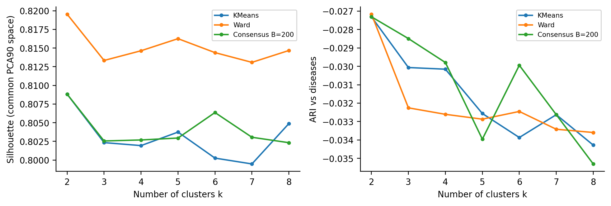
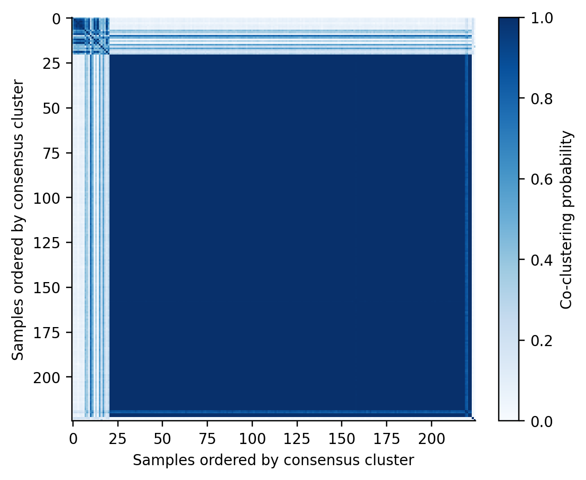
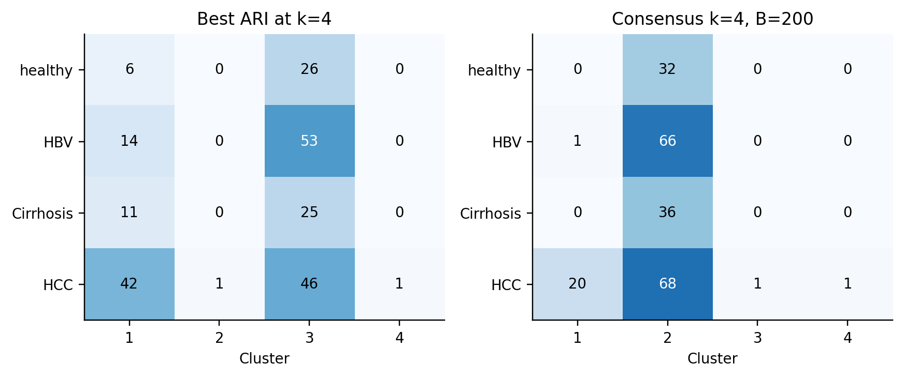

# 一、实验目的与数据

掌握 K-means、层次聚类的构建、评估与调参方法，尝试重采样一致性聚类，
分析 CNV 数据的几何聚集与已知疾病类别是否一致。按照指导书和简短要求，
报告包含方法、流程、结果及完整代码；结构和 Python 技术路线参考 Exp1 实验记录。

数据文件为 `HCC_CNV_data.mat`。`ma` 原始维度为 2475×225，转置后为
225×2475（行对应样本）；`sample` 为 225×2，第一列是样本 ID，第二列是类别。
标签直接读取该列，与特征逐行对齐，不沿用 Exp1 的 `co` 编码，也不按 ID 前缀推断类别。

| 类别      |   样本数 |   全部特征为2 |   组内不同向量数 |
|:----------|---------:|--------------:|-----------------:|
| healthy   |       32 |            26 |                5 |
| HBV       |       67 |            53 |                4 |
| Cirrhosis |       36 |            25 |                5 |
| HCC       |       90 |            42 |               41 |

**质量检查**：无缺失或非有限值，无重复 ID，无零方差特征，特征取值为 1～5。
但全体样本仅有 **46 种不同特征向量**，146/225（64.89%）的样本所有特征均为 2，
且这 146 例分属四类。组内不同向量数之和不能作为全体不同向量数，因为向量跨组重复。
这些样本的 ID 不同，不直接视为错误记录或删掉；重复向量会影响聚类形态与评估。
本实验无法判断其源于生物学相似、离散化还是其他上游处理。

# 二、处理流程

1. 加载与转置矩阵，核对 ID、标签、维度与有限性，记录重复特征向量。
2. 按特征进行 Z 分数标准化；PCA 使用完整 SVD，按累计方差选维数。
3. 主流程保留 **17 个主成分**，累计解释方差 **90.08%**；80%/95% 分别需
   12/22 维。前两维仅解释 30.35%，只用于作图，实际聚类使用 17 维。
4. 扫描 K-means 的 k=2～8，并比较表示方法与初始化次数；扫描层次聚类的
   距离/连接方式；另用 PAM 比较不同距离；构建重采样一致性矩阵。
5. 计算内部指标与疾病标签外部指标，保存配置表、每个样本的簇归属和图形。

所有标准化、PCA、方差筛选及聚类拟合均不使用疾病标签。
方差 top500 在**未标准化矩阵**上计算后排序，随后标准化并 PCA。
总体为探索性全样本聚类，未设置独立测试集；固定 k=4 的 ARI 调参比较是对当前数据
的事后描述，不代表对新病人的预测性能。

\newpage

# 三、方法与评价指标

**K-means**：使用 k-means++ 初始化、Lloyd 迭代，最小化平方欧氏簇内距离；
主扫描 `random_state=42, n_init=50`。标准 K-means 不能直接替换成任意距离，
因此距离比较另外采用 **K-medoids/PAM**，以真实样本为中心，8 次初始化并穷举中心交换。
它与 K-means 的目标函数不同，报告中分别列出。

**层次聚类**：欧氏/曼哈顿/余弦距离 × single/complete/average 连接，另加欧氏 Ward，
共 10 种合法组合，均扫描 k=2～8。Ward 只用于欧氏距离。

**一致性聚类**：每次无放回抽取 80% 样本，K-means（`n_init=10`）拟合。
对每个样本对，以同簇次数除以共同出现次数得到共识矩阵 C，
在 1−C 上用 average 层次聚类。B=50/100/200 为同一 200 次序列的前缀，k=2～8。
PCA 表示固定，重采样评价的是该表示下聚类的稳定性。

**指标**：轮廓系数 s=(b−a)/max(a,b)，a 为簇内平均距离，b 为最近其他簇平均距离，
越高越好，单点簇按定义记为 0；DB 越低越好；RI 为样本对关系的一致比例；
ARI 校正随机一致性，1 表示完全一致，近 0 表示接近随机基线，允许为负。
另保存 NMI。RI/ARI 不需要把簇编号映射为疾病名称。

表中默认轮廓系数与 DB 均在同一个 **Z 分数 PCA90% 欧氏空间**计算，便于比较分区；
各方案自身空间/距离的轮廓系数另存 `silhouette_fit`。疾病标签只用于 RI、ARI、NMI。

# 四、实验结果：簇数选择

|   k |   轮廓系数 |     DB |     RI |     ARI | 簇大小             |
|----:|-----------:|-------:|-------:|--------:|:-------------------|
|   2 |     0.8088 | 1.8555 | 0.3417 | -0.0273 | 205/20             |
|   3 |     0.8023 | 1.6232 | 0.3469 | -0.0301 | 203/20/2           |
|   4 |     0.8019 | 1.1407 | 0.3469 | -0.0302 | 203/20/1/1         |
|   5 |     0.8037 | 1.0669 | 0.3363 | -0.0326 | 206/15/2/1/1       |
|   6 |     0.8003 | 1.0596 | 0.3457 | -0.0339 | 203/16/2/2/1/1     |
|   7 |     0.7995 | 0.8229 | 0.3334 | -0.0326 | 207/12/2/1/1/1/1   |
|   8 |     0.8049 | 0.7786 | 0.3359 | -0.0343 | 206/12/2/1/1/1/1/1 |

在主流程 K-means 扫描中，轮廓系数最高为 **k=2，0.8088**，而 DB 最低为
k=8，0.7786，两项指标的选择并不一致。采用轮廓系数时选 k=2；保留 k=4
作为已知四类疾病的对照。四簇 ARI 为 −0.0302，不能恢复疾病分组。

{width=14cm}

\newpage

# 五、表示方法与距离参数调优（k=4）

| 表示方法          |   统一空间轮廓系数 |     ARI |
|:------------------|-------------------:|--------:|
| PCA80%            |             0.8002 | -0.0358 |
| PCA90%            |             0.8019 | -0.0302 |
| PCA95%            |             0.8019 | -0.0302 |
| 全特征Z分数       |             0.8023 | -0.0317 |
| 原始值PCA90%      |             0.7755 | -0.0378 |
| 方差top500+PCA90% |             0.6253 | -0.0217 |

PCA95% 与 PCA90% 在本次运行中给出相同分区，故统一空间指标相同；
它们的自身空间轮廓系数分别为 0.7929 和 0.8019。方差筛选使 ARI 略有变化，
但仍为负，未得到可靠的疾病分组。不能从 Exp1 的片段模式数据结果推断 CNV 数据也有效。

**层次聚类的参数比较：**

| 样本距离   | 连接方式   |   统一空间轮廓系数 |     ARI |
|:-----------|:-----------|-------------------:|--------:|
| euclidean  | single     |             0.8388 | -0.0055 |
| euclidean  | complete   |             0.8318 | -0.013  |
| euclidean  | average    |             0.8388 | -0.0055 |
| euclidean  | ward       |             0.8146 | -0.0326 |
| manhattan  | single     |             0.8317 | -0.0079 |
| manhattan  | complete   |             0.8204 | -0.0127 |
| manhattan  | average    |             0.8317 | -0.0079 |
| cosine     | single     |             0.5109 |  0.0059 |
| cosine     | complete   |             0.6554 | -0.0162 |
| cosine     | average    |             0.6571 | -0.0282 |

欧氏 single/average 的轮廓系数较高，但形成 222/1/1/1 的极端分区。
最高疾病 ARI 是余弦 single 的 **0.0059**，簇大小为 150/73/1/1，
仍接近随机基线。这里“最高”只指测试配置中的相对最高值。

**PAM 的距离比较：**

| PAM距离   |   原距离轮廓系数 |   统一空间轮廓系数 |     ARI |
|:----------|-----------------:|-------------------:|--------:|
| euclidean |           0.5635 |             0.5635 | -0.015  |
| manhattan |           0.5499 |             0.5366 | -0.014  |
| cosine    |           0.8212 |             0.6954 | -0.0058 |

PAM 的余弦距离结果优于其欧氏/曼哈顿方案的 ARI，但仍为 −0.0058。
余弦距离的 0.8212 与欧氏空间的 0.6954 度量不同，不能直接当成算法优劣差距。

\newpage

# 六、随机初始化与一致性聚类

**K-means 初始化稳定性**：固定主流程表示与 k=4，对每个 `n_init` 使用
种子 0～19，计算 20 次分区之间全部 190 对 ARI。
这里的“运行间 ARI”比较不同运行的分区，区别于与疾病标签比较的 ARI。

|   初始化次数 |   运行间ARI均值 |   运行间ARI最小值 |   惯性标准差 |
|-------------:|----------------:|------------------:|-------------:|
|            1 |          0.4119 |           -0.0135 |     22004.2  |
|           10 |          0.8879 |            0.706  |      6787.22 |
|           50 |          0.937  |            0.803  |      1626.77 |

增加初始化次数，将运行间 ARI 均值从 0.4119 提高至 0.9370，惯性标准差也下降。
因此重复初始化确实改善稳定性，但 `n_init` 是从多次初始化中选择最小惯性结果，
**不等同于构建一致性矩阵**。

**一致性聚类重采样次数比较：**

|   重采样次数 |    PAC |   轮廓系数 |   疾病ARI | 簇大小     |
|-------------:|-------:|-----------:|----------:|:-----------|
|           50 | 0.1529 |     0.8019 |   -0.0302 | 203/20/1/1 |
|          100 | 0.1135 |     0.8019 |   -0.0302 | 203/20/1/1 |
|          200 | 0.112  |     0.8027 |   -0.0298 | 202/21/1/1 |

PAC 在本实验定义为非对角样本对中 0.1<C<0.9 的比例，越低表示模糊共聚类的
样本对越少。B=200 时，任意样本对至少共同出现 100 次；
B=50/100 的分区相同，B=200 有小幅变化，但疾病 ARI 仍为 −0.0298。
本实验 k=2～8 的 B=200 PAC 从 0.1750 降至 0.0863，
因此也不能仅凭 PAC 越小，就把更大的 k 认定为真实疾病簇数。

{width=8.5cm}

\newpage

# 七、结果汇总与分析

| 固定4簇：各方法最高ARI方案   |   轮廓系数 |     RI |     ARI | 簇大小       |
|:-----------------------------|-----------:|-------:|--------:|:-------------|
| 层次（cosine/single）        |     0.5109 | 0.4831 |  0.0059 | 150/73/1/1   |
| PAM（cosine）                |     0.6954 | 0.4983 | -0.0058 | 151/42/26/6  |
| K-means（方差top500）        |     0.6253 | 0.4793 | -0.0217 | 156/44/14/11 |
| 一致性（B=200）              |     0.8027 | 0.3502 | -0.0298 | 202/21/1/1   |

上述表格按每种方法在 k=4 时的**疾病 ARI**选出代表方案，是标签辅助的事后比较。
它没有改变聚类拟合本身，也不能当作无偏的泛化性能估计。

{width=13.5cm}

**为何内部指标高而疾病一致性低？** 146 个相同向量涵盖健康 26、HBV 53、
肝硬化 25、HCC 42 例。本次全部 136 个配置均将相同向量保持在同一簇，
因此无法把这些样本分别放入正确的疾病组。高轮廓系数主要反映大簇与少数偏离样本的
几何分离；全配置中最高统一空间轮廓系数 0.8646 对应欧氏 average 的 k=2，
簇大小为 **224/1**，ARI 仅 −0.0027，更说明需同时查看簇大小与外部指标。

**实验结论**：在本数据及已测试参数范围内，K-means、层次聚类、PAM 和
一致性聚类均未恢复四类疾病分组。距离、降维阈值和初始化次数会改变分区，
其中多次初始化改善稳定性，但稳定的几何簇不等于有效的疾病分型。
即使固定 k=4 时最高 ARI 为正，其数值 0.0059 也不足以支持“分型成功”。

**局限**：仅分析一个离散 CNV 矩阵；重复向量、类别不平衡及 PCA 以总体方差为目标
会限制解释。未获得 CNV 特征的基因组位置、批次信息或上游处理说明，不能解释具体
生物学机制，也不能据此否定 CNV 的全部诊断价值。后续可核查原始连续信号和批次，
结合其他分子/临床信息，并在独立样本中验证；本次没有把这些建议写成已完成实验。

